# Write-up: Team Cryptographers

Challenge 2, Ten Locks, One Message. We opened all ten files. Every answer matches its hash in the official checker (`tools/check_submission.py`, full mode), and every tier runs a circuit on Aer inside `solve()`. Each tier folder also holds an `EXPLAINED.md` with more detail, an `explore.py` that compares methods (with its printed output), and a diagram.

## The message

| Tier | Line |
|---|---|
| 1 | QC-01: Meet at the Oval when the clock reads 6:47 |
| 2 | QC-02: bring 3 buckeyes, a blue pen |
| 3 | QC-03: Mirror Lake hides a brass key by the northeast rock |
| 4 | QC-04: Brutus will whistle Carmen Ohio slightly off-key |
| 5 | QC-05: count the lamps on the Long Walk: there are nineteen |
| 6 | QC-06: the Thompson Library elevator stops twice on floor 8 |
| 7 | QC-07: ask the night librarian for Folio 1870-Q, not 1870-R |
| 8 | QC-08: inside is a map of old tunnels under Ohio Stadium |
| 9 | QC-09: follow it south past Gate 17 to a door painted scarlet |
| 10 | QC-10: knock four times, shout O-H, and wait for the I-O |

## Summary of what each scored circuit costs

Numbers come from `check_submission.py` after transpiling to `rz, sx, x, cx`. The scored circuit is the largest one `solve()` sends to Aer.

| Tier | Algorithm | Qubits | Two-qubit gates | Depth | Total gates | Shots |
|---|---|---|---|---|---|---|
| 1 | Bernstein-Vazirani | 25 | 143 | 44 | 290 | 16 |
| 2 | BB84 | 1 | 0 | 3 | 3 | 1 (2,048 circuits) |
| 3 | Deutsch-Jozsa | 7 | 7,808 | 8,771 | 19,497 | 16 per oracle, 24 oracles |
| 4 | Simon | 20 | 179 | 195 | 451 | 40 |
| 5 | Grover | 19 | 4,750 | 4,960 | 14,588 | 256 |
| 6 | Grover, 64 marked keys | 16 | 2,064 | 2,826 | 6,948 | 4,096 |
| 7 | Iterative phase estimation | 2 | 2 | 11 | 16 | 64 per round, 14 rounds |
| 8 | Shor, N = 35 | 9 | 5,053 | 10,406 | 14,920 | 24 |
| 9 | Shor, N = 77 | 10 | 23,968 | 45,696 | 70,246 | 24 |
| 10 | Shor for discrete log, p = 83 | 10 | 13,157 | 26,112 | 37,393 | 40 |

In tiers 1, 3 and 4 almost every two-qubit gate belongs to the oracle the tier provides. Our own gates there are only Hadamards and X.

Tier 7 shows the checker's note "scored circuit has under 8 active qubits". `SCORING.md` calls this a request for review. We explain the construction in the tier 7 section: one control qubit is measured, reset and reused 14 times.

---

## Tier 1: The Parity Vault

| Item | Our result |
|---|---|
| Shots per circuit and total circuit executions | 1 circuit, 16 shots |
| Oracle applications per shot and total | 1 per shot, 16 in total |
| Measured outcomes, their frequencies, and key extraction | `110001111100110101001001` in 16 of 16 shots. `s = int(outcome, 2)`, `s.to_bytes(3, "big")` is the repeating XOR key |
| Scored two-qubit gates, depth, total gates, active qubits | 143, 44, 290, 25 |
| Classical preprocessing and post-processing | None before. After: convert the string to 3 key bytes and `xor_repeating` the ciphertext |

### What the file hid, and how we identified the approach
The line is XORed with a repeating 3-byte key, which is a hidden 24-bit string s. The oracle answers one kind of question: for an input x it flips the target by the parity s·x. Classically each question gives one bit, so 24 bits need 24 questions, and the tier allows one oracle call. A hidden string behind a parity oracle, with one query, is the Bernstein-Vazirani problem.

### Why our approach works
1. Put the target qubit in |−⟩ (X then H). The oracle's flip of the target then shows up as a sign on the input instead (phase kickback).
2. Hadamards on the 24 input qubits put every x into the state at once, all with sign +.
3. One oracle call gives each x the sign (−1)^(s·x).
4. Hadamards again turn that sign pattern back into the basis state |s⟩. Measuring the inputs gives s with probability 1, so one shot is enough. We ran 16 as evidence.

### Circuit diagram with qubit and gate counts
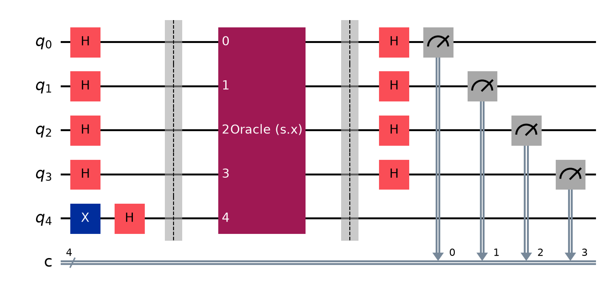

Drawn for 4 bits; the real circuit has 24. It uses 25 qubits (24 inputs and a target). Our own gates are 1 X and 49 Hadamards, with no two-qubit gates. The oracle adds the rest of the 143 two-qubit gates.

### Measurement result and key extraction
All 16 shots returned the same 24-bit string. It gives the key bytes and the decrypted line above.

### Classical cost for comparison
Classically: 24 questions (one per bit), or 25.7 on average with random questions. Brute force over all 2^24 strings took about 6 s on this machine and would take years at 48 bits. The quantum gain is in the number of questions, a linear gap (24 against 1). Without the |−⟩ target, a test circuit succeeded only 50% of the time.

---

## Tier 2: Two Links

| Item | Our result |
|---|---|
| Shots per circuit and total circuit executions | 1 shot per circuit (each qubit can be measured once). 2,048 circuits: 1,024 per link |
| Oracle applications per shot and total | None. The qubits arrive from the provided channel |
| Measured outcomes, their frequencies, and key extraction | After sifting: `link_A` 143 check bits, 0 wrong (0%); `link_B` 125 check bits, 26 wrong (20.8%). Key rebuilt from the 383 sifted non-check bits of `link_A` |
| Scored two-qubit gates, depth, total gates, active qubits | 0, 3, 3, 1 |
| Classical preprocessing and post-processing | Seeded random choice of bases before `finish()`. After: sifting, error count on the check set, drop the check bits, `helper.reconcile` (a GF(2) solve) |

### What the file hid, and how we identified the approach
The key was sent as 1,024 qubits on each of two links, each qubit in a random basis (Z or X). Eve measures and resends every qubit on one link. Random bases, an eavesdropper and a public check set describe BB84.

### Why our approach works
We choose a random basis for every qubit before Alice reveals hers (Z: measure; X: one H, then measure). Where our basis matches hers, our bit equals hers. Eve guesses the basis too. She is wrong half the time, and then half of those qubits flip for us, so a tapped link shows 25% errors on the public check bits and a clean link shows none.

### Circuit diagram with qubit and gate counts
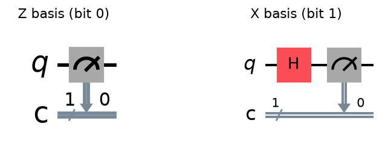

Each circuit is 1 qubit and 1 classical bit: Z basis has 0 gates, X basis has one H. The checker reports 3 gates and depth 3 because it breaks the H into basic rotations.

### Measurement result and key extraction
`link_A` is clean, so we use it. 383 sifted bits that are not in the check set solve the 280-bit key. `link_B` would give a key that decrypts to garbage. The measured 20.8% sits below the 25% expectation because 125 check bits is a small sample.

### Classical cost for comparison
A classical channel cannot detect a copy, so there is nothing to compare. The quantum cost is 1,024 qubits per link for a 280-bit key, which is about 27% efficiency (half is lost to sifting, a quarter to the check). In `explore.py` on our own simulated links: random bases and a fixed Z basis both detect Eve (25.8% and 25.0%); skipping the sifting leaves 25% of bits wrong even without Eve; with Eve on 10% of the qubits the check shows 3.1%, in line with 25% × the fraction tapped.

---

## Tier 3: Twenty-Four Seals

| Item | Our result |
|---|---|
| Shots per circuit and total circuit executions | 24 circuits (one per oracle), 16 shots each, 384 executions |
| Oracle applications per shot and total | 1 per shot, 384 in total (24 per distinct circuit) |
| Measured outcomes, their frequencies, and key extraction | Constant oracles: `000000` in 16 of 16 shots, key bit 0. Balanced oracles (0, 1, 4, 6, 7, 10, 12, 16): never `000000`, key bit 1. Key `110010110010100010000000` |
| Scored two-qubit gates, depth, total gates, active qubits | 7,808, 8,771, 19,497, 7 |
| Classical preprocessing and post-processing | None before. After: classify each oracle from its counts, join 24 bits, `keystream` XOR |

### What the file hid, and how we identified the approach
Each key bit is hidden in a function on 6 bits that is promised to be constant (bit 0) or balanced (bit 1). We may ask each oracle once. Constant or balanced, with a promise and one query, is the Deutsch-Jozsa problem.

### Why our approach works
Phase kickback with the target in |−⟩ turns the oracle into a sign (−1)^f(x) on every input at once. Hadamards on the inputs before and after add the signs up: the chance of reading `000000` is the square of the average sign. Constant gives 1, balanced gives exactly 0, so one shot per oracle decides.

### Circuit diagram with qubit and gate counts
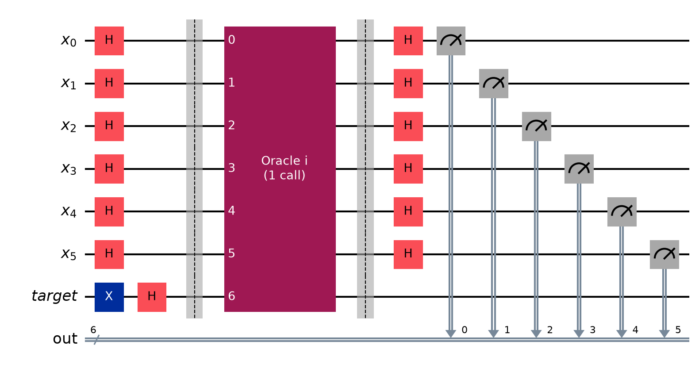

7 qubits (6 inputs, 1 target). Our part is 1 X and 13 Hadamards, with no two-qubit gates. The scored size is the provided oracle.

### Measurement result and key extraction
The histograms on the slides show one constant oracle (all 16 shots `000000`) and one balanced oracle (twelve different strings, never `000000`). Oracle 0 to 23 gives the 24-bit key.

### Classical cost for comparison
To be certain, classical needs 2^(n−1) + 1 = 33 questions per oracle (792 for all 24), because a "sneaky" balanced function can give 32 equal answers first. Random guessing with k questions is wrong about 2^−(k−1) of the time, so 10 questions still leave 0.1% error. The quantum gap is exponential only for exact answers.

---

## Tier 4: The Echo

| Item | Our result |
|---|---|
| Shots per circuit and total circuit executions | 1 circuit, 40 shots |
| Oracle applications per shot and total | 1 per shot, 40 in total |
| Measured outcomes, their frequencies, and key extraction | 37 distinct strings y in 40 shots, every one with y·s = 0 (mod 2). The equations leave a null space of dimension 1: s = `1100011000` |
| Scored two-qubit gates, depth, total gates, active qubits | 179, 195, 451, 20 |
| Classical preprocessing and post-processing | After: Gaussian elimination over GF(2) on the measured y, then `keystream` XOR |

### What the file hid, and how we identified the approach
A 10-bit key s is hidden in a function that is exactly 2-to-1 with f(x) = f(x ⊕ s). Finding a repeated answer by asking one input at a time is a birthday search. A hidden XOR shift of a 2-to-1 function is Simon's problem.

### Why our approach works
Hadamards on the inputs, one oracle call, then Hadamards again. The inputs x and x ⊕ s share an output, so they interfere, and only outcomes y with y·s = 0 survive. Each run is a random y and one linear equation about s. About 9 independent equations pin down s, and we solve them classically.

### Circuit diagram with qubit and gate counts
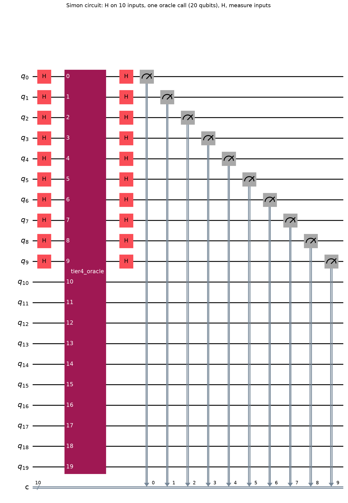

20 qubits (10 inputs, 10 outputs). Our part is 10 Hadamards before and 10 after, with no two-qubit gates.

### Measurement result and key extraction
With 40 shots we had far more equations than needed. On average about 11 runs suffice (measured: 29% chance with 9 runs, 58% with 10, 89% with 12). The solution raises an error if more than one s remains.

### Classical cost for comparison
Classical: 1,024 queries for certainty (513 worst case for a sequential scan), about 40 for a random birthday search. Simon: about 11 runs. We measured the trend on oracles of 5, 8 and 11 bits: Simon needs 7, 7.8 and 10.2 runs while the birthday search needs 7.2, 19.9 and 57. Extrapolated to n = 64, that is about 66 runs against about 5 × 10^9 queries. This is an exponential gap, but the oracle grows with n and that is where the gates are. A Grover search for s also works but needs 7,310 two-qubit gates, about 40 times Simon's.

---

## Tier 5: The Small Safe

| Item | Our result |
|---|---|
| Shots per circuit and total circuit executions | 1 circuit, 256 shots |
| Oracle applications per shot and total | 25 per shot (one per Grover round), 6,400 in total |
| Measured outcomes, their frequencies, and key extraction | Key 263 in 256 of 256 shots. `solve()` decrypts measured keys, most frequent first, and keeps the one whose plaintext starts with `QC-05:` |
| Scored two-qubit gates, depth, total gates, active qubits | 4,750, 4,960, 14,588, 19 |
| Classical preprocessing and post-processing | Before: derive 16 key equations from the cipher's structure and the known `QC`, plan the oracle (shared Toffolis, in-place evaluation). After: decrypt and check the prefix |

### What the file hid, and how we identified the approach
A toy byte cipher with a 10-bit key (1,024 keys). We know the line starts with `QC-05:`, so "does this key decrypt to QC" is a yes/no test. The tier asks for the test as a reversible oracle. Finding the one key that passes a yes/no test is Grover search. A single known byte is not enough: 4 keys decrypt it to `Q`. Two bytes leave exactly one, so the oracle checks both.

### Why our approach works
Start with an equal mix of all keys. The oracle flips the sign of the key that passes. The diffusion step reflects every amplitude about the average, which makes the flipped key's amplitude grow. Each round rotates the state by 2θ with sin θ = √(1/1024). After about (π/4)·√1024 = 25 rounds almost all the probability is on the right key. Too few rounds leave the key hidden, and too many rotate past it (50 rounds gave 0%).

### Circuit diagram with qubit and gate counts
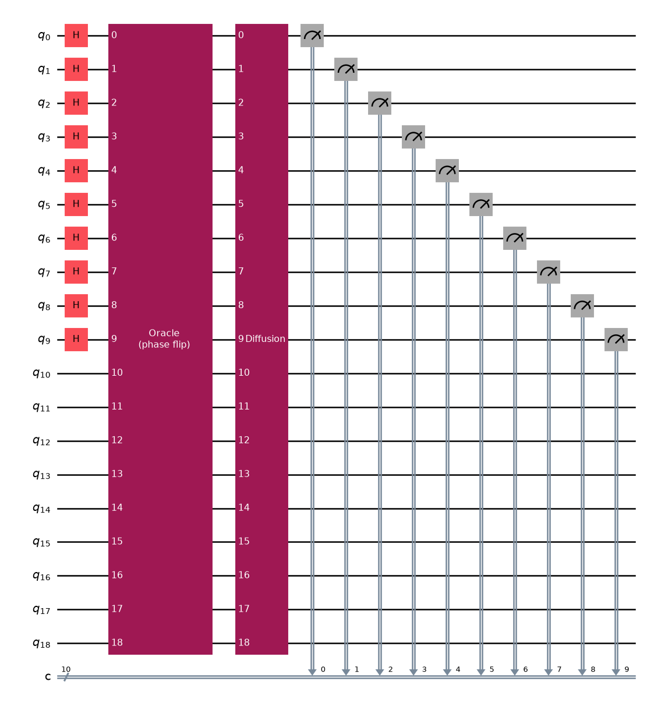
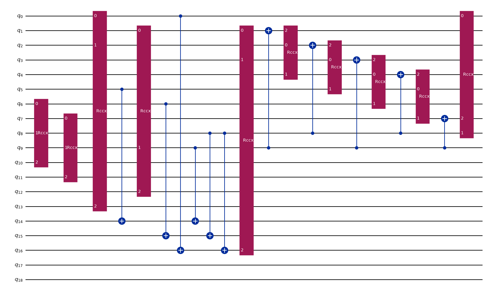

19 qubits: 10 key, 7 scratch, 2 clean helpers for the multi-controlled Z. 190 two-qubit gates per round. Decrypting a byte is XOR, S-box, permutation, and only the XOR mask depends on the key, so "byte i decrypts correctly" becomes "the mask equals a known constant". Each mask bit is `k[a] ⊕ k[b] ⊕ (k[c] ∧ k[d])`. Three savings: shared Toffolis between the two bytes, evaluating an equation in place on one of its own key qubits, and relative-phase Toffolis (3 CX instead of 6) whose extra phases cancel because the oracle is W⁻¹ Z W. Compared with a plain-Toffoli build, this saves 32% of the CX gates.

### Measurement result and key extraction
256 of 256 shots gave key 263. Success against the number of rounds follows sin²((2k+1)θ): Aer gave 1.000 at k = 25 against 0.999 in theory, 38% at 10 rounds, 34% at 40.

### Classical cost for comparison
Classical brute force over all 1,024 keys took 10 ms, with about 512 tries on average. Our Grover run uses 25 rounds and 2.5 s to simulate, so at this size the classical search is faster. The scaling is the point: 128-bit keys need about 1.7 × 10^38 classical tries against about 2^64 Grover rounds, a square-root gain, which is why doubling the key length is the standard defence.

---

## Tier 6: The Bigger Safe

| Item | Our result |
|---|---|
| Shots per circuit and total circuit executions | 1 circuit, 4,096 shots |
| Oracle applications per shot and total | 12 per shot, 49,152 in total |
| Measured outcomes, their frequencies, and key extraction | 65 distinct keys. 64 are passing keys, each seen 42 to 87 times, and one is a stray single shot. Decrypting all and applying the public checksum leaves only key 5401 |
| Scored two-qubit gates, depth, total gates, active qubits | 2,064, 2,826, 6,948, 16 |
| Classical preprocessing and post-processing | Before: 8 key equations from the first byte, plan the oracle, work out M = 64. After: decrypt each measured key and filter by the checksum (sum of the plaintext bytes mod 256) |

### What the file hid, and how we identified the approach
The same toy cipher with a 14-bit key (16,384 keys). We trust only the first byte `Q`, so about 64 keys pass, and a public checksum separates the true key from the decoys. Finding one of several marked items is Grover with M marked items.

### Why our approach works
Grover rotates by 2θ per round with sin θ = √(M/N). With M = 64 and N = 16,384, sin θ = 1/16 and we need (π/4)·√(N/M) ≈ 12 rounds. We know M = 64 because all 8 equations can be written in place on the key qubits k0 to k7, each depending only on higher-index qubits, so for each of the 2^6 values of k8 to k13 exactly one (k0..k7) fits (checked by brute force too). The circuit cannot tell the 64 keys apart, so each shot is a random one of them.

### Circuit diagram with qubit and gate counts
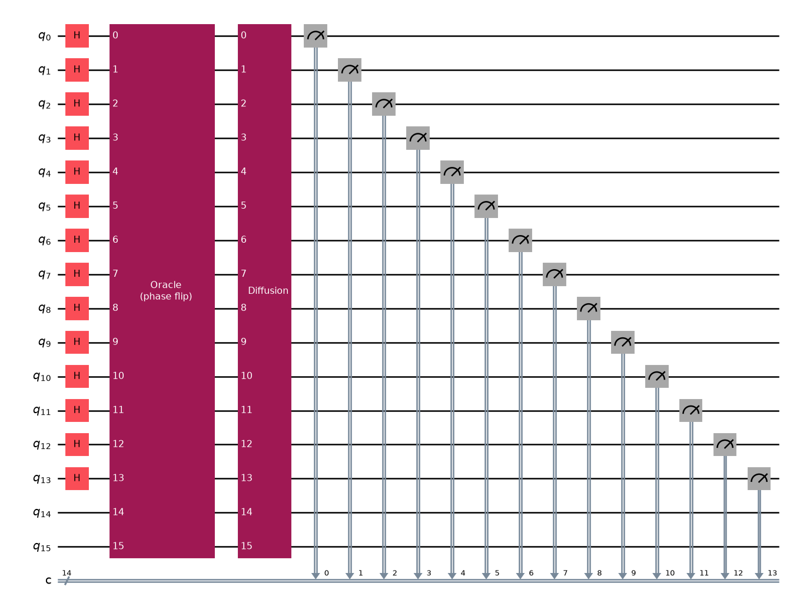
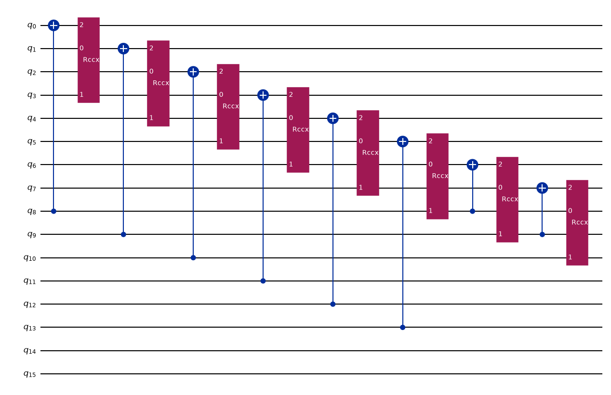

16 qubits (14 key, 2 clean helpers, no scratch qubits). 172 two-qubit gates per round, 12 rounds.

### Measurement result and key extraction
The histogram on the slides shows the shots spread over the 64 passing keys. `solve()` raises an error unless the checksum filter leaves exactly one key. Failed or costly variants we tried: guessing M wrongly (1, 256 or 1,024) gives 0%, 55% and 19% success; fitting the success curve estimated M = 66 against the true 64; trusting two bytes (M = 2) needs 71 rounds and 8 times the CX.

### Classical cost for comparison
Classical staged attack (byte 0 first, then the checksum on the survivors): 0.11 s, with about 8,192 tries on average. Grover needs 12 rounds. At this size classical wins on time. Because the first-byte test leaves M = 2^(n−8) keys, the number of rounds stays near 12.6 for any key size, and the cost moves to the classical filter, which grows with n.

---

## Tier 7: The Hidden Angle

| Item | Our result |
|---|---|
| Shots per circuit and total circuit executions | 14 circuits (one per bit), 64 shots each, 896 executions. Real hardware: 28 circuits in one job, 1,024 shots each |
| Oracle applications per shot and total | One controlled U^(2^j) gate per round, 14 per full estimate, 896 in total. The power of U is built from the matrix of U as one gate, as the tier allows |
| Measured outcomes, their frequencies, and key extraction | Each round gives one bit: `1,1,1,0,0,0,1,0,0,0,1,0,1,1`, lowest bit first. k = `11010001000111` = 13,383 |
| Scored two-qubit gates, depth, total gates, active qubits | 2, 11, 16, 2 |
| Classical preprocessing and post-processing | Before: `matrix_power` of U for each power. Between rounds: a phase gate with angle −2π·(bits so far)/2^(m+1). After: join the bits, `keystream` XOR |

### What the file hid, and how we identified the approach
A one-qubit gate U has eigenvalues 1 and e^(2πiφ), with φ = k/2^14. We are given U and the state it leaves alone but not the angle. Reading a phase out of a unitary, with an exact binary expansion, is phase estimation.

### Why our approach works
A controlled U on that state does not change the target. It twists the control qubit by 2πφ (phase kickback). U^(2^j) twists it by 2πφ·2^j, so for exact 14-bit φ the twist 2^13·φ is half a turn if the last bit is 1 and nothing if it is 0. A Hadamard turns that into a certain 0 or 1. Textbook phase estimation uses 14 control qubits and an inverse QFT. We do the QFT semiclassically: one control qubit, measured and reset 14 times. Round m reads bit m (lowest first) and a single phase gate removes the part of the twist caused by the bits already known. Every round is deterministic, so no statistics are needed.

### Circuit diagram with qubit and gate counts
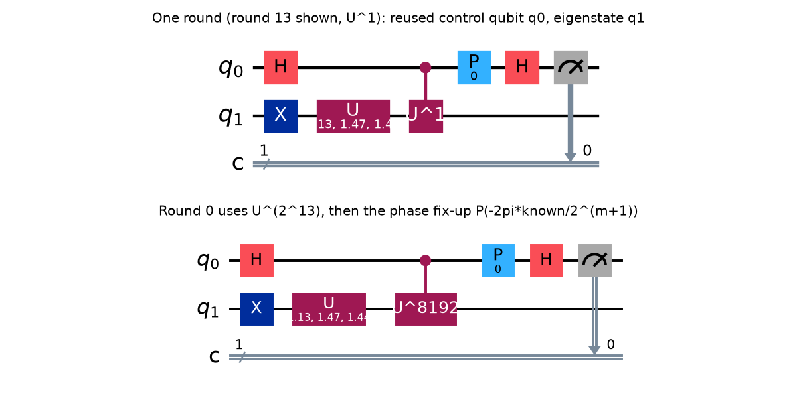

2 qubits: the recycled control and the eigenstate. 2 two-qubit gates per round. The textbook version needs 15 qubits and 230 two-qubit gates. Because the control qubit is reset and reused, the checker flags fewer than 8 active qubits. The flag is allowed for exactly this technique, and the 14 measurements in order are what give the key.

### Measurement result and key extraction
Fourteen rounds, one bit each, as listed in the table. k = 13,383 decrypts the line.

### Classical cost for comparison
Brute force over all 16,384 keys takes 0.06 s. Repeated single measurements of U need about 1.3 × 10^8 shots to round correctly about 99% of the time (precision 2^−n needs about 4^n shots). Phase estimation uses U about 2^n times in total (16,383 here), the same as brute force over keys, but far fewer than repeated measurement. This toy hides that cost, because U^(2^j) is built from U's matrix as one gate.

---

## Tier 8: The Wrapped Key, N = 35

| Item | Our result |
|---|---|
| Shots per circuit and total circuit executions | 1 circuit (base a = 2), 24 shots |
| Oracle applications per shot and total | 10 controlled multipliers per shot (one per round), 240 in total |
| Measured outcomes, their frequencies, and key extraction | 24 values of y (10 bits). Peaks at multiples of 1,024/12: for example 85, 171, 427, 597, 683, 853, 939, plus 0, 256 and 512 when s shares a factor with 12. Smallest r with 2^r ≡ 1 mod 35 from continued fractions and lcms: r = 12, so 35 = 5 × 7 |
| Scored two-qubit gates, depth, total gates, active qubits | 5,053, 10,406, 14,920, 9 |
| Classical preprocessing and post-processing | Before: gcd check on the base, compute b = a^(2^j) mod N and build the permutation for each multiplier. After: continued fractions, gcd(a^(r/2) ± 1, N), RSA unwrap, `keystream` XOR |

### What the file hid, and how we identified the approach
The 6-bit key k is wrapped with RSA: N = 35, e = 5, wrapped key c = 23. Unwrapping needs d, which needs the factors of N. The hint about the order r with a^r ≡ 1 (mod N) is the step in Shor's algorithm. The rules forbid classical factoring in the solution.

### Why our approach works
Powers of 2 mod 35 repeat with period r = 12. Then 2^6 mod 35 = 29, gcd(28, 35) = 7 and gcd(30, 35) = 5. The quantum part finds r: multiplication by 2 mod 35 is a reversible step that acts like a hand turning 1/12 of a circle, and phase estimation returns a fraction s/12 for a random s. We measure 10 bits y, so y/1,024 ≈ s/12, and continued fractions recover the denominator. As in tier 7, one control qubit is reused (10 rounds) instead of 10 counting qubits. Unwrapping: φ(35) = 24, d = 5, k = 23^5 mod 35 = 18, key bits `010010`.

### Circuit diagram with qubit and gate counts
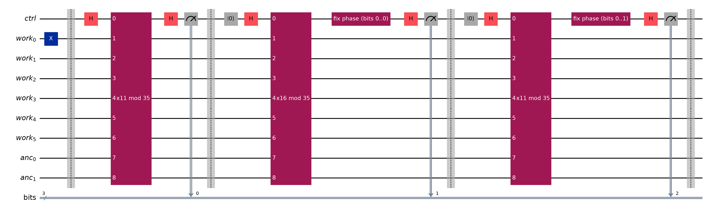

9 qubits: 1 control, 6 work, 2 helper ancillas. Multiplying by b only reorders the numbers 1 to 34, so we build each controlled multiplier as a chain of swaps of two values (CNOTs and one multi-controlled X each). The work register never holds 0 or values of 35 or more, so those patterns are "don't care" and some controls are dropped. Each construction is checked classically on all 34 inputs.

### Measurement result and key extraction
The histogram on the slides shows the peaks. A shot with s = 0, 3 or 6 gives a smaller denominator, which is why we try lcms of pairs. Base a = 34 would give only trivial factors (its order is 2, and 34 ≡ −1), so `factor` skips bases that fail and tries the next. With a = 2, 8 shots find the factors 99.6% of the time (measured by resampling 240 real shots) and 24 shots 100%.

### Classical cost for comparison
Trial division: 4 divisions. Pollard rho: 1 round. Both take well under a microsecond, a million times faster than our simulation. Textbook Shor (10 counting qubits and an inverse QFT) uses 18 qubits and 4,966 two-qubit gates, so recycling halves the qubits for about the same gate count and runs about 75 times faster in simulation. A Grover search over 32 candidate pairs also factors 35 with 12 qubits and 1,776 two-qubit gates (96% per shot), about a third of Shor's gate count. The best classical algorithm (number field sieve) is sub-exponential and Shor is polynomial in the number of bits.

---

## Tier 9: The Wrapped Key, N = 77

| Item | Our result |
|---|---|
| Shots per circuit and total circuit executions | 1 circuit (base a = 2), 24 shots |
| Oracle applications per shot and total | 12 controlled multipliers per shot, 288 in total |
| Measured outcomes, their frequencies, and key extraction | 24 values of y (12 bits), including 137, 1,775, 2,321 and 3,140, which sit at multiples of 4,096/30. Continued fractions give r = 30, so 77 = 7 × 11 |
| Scored two-qubit gates, depth, total gates, active qubits | 23,968, 45,696, 70,246, 10 |
| Classical preprocessing and post-processing | The same as tier 8 with N = 77 and 12 rounds. d = 43, k = 59^43 mod 77 = 31, key bits `0011111` |

### What the file hid, and how we identified the approach
The same wrapped key as tier 8 with N = 77, e = 7, wrapped key c = 59. We need the factors of N, so the approach is Shor's algorithm again.

### Why our approach works
Powers of 2 mod 77 repeat with period r = 30, and 2^15 mod 77 = 43 gives gcd(42, 77) = 7 and gcd(44, 77) = 11. We measure 12 bits (2^12 ≥ 77²/2) with one recycled control qubit, so y/4,096 ≈ s/30.

### Circuit diagram with qubit and gate counts
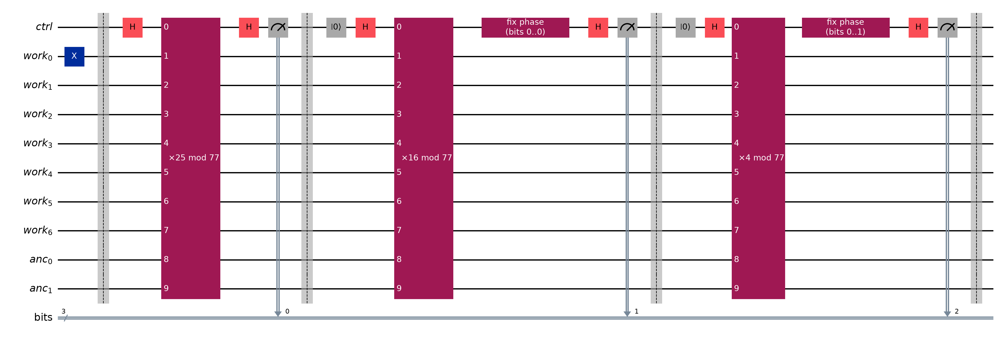

10 qubits: 1 control, 7 work, 2 helper ancillas. The multipliers are built as in tier 8, as permutations of 1 to 76.

### Measurement result and key extraction
The listed values of y match 1/30, 13/30, 17/30 and 23/30 of 4,096, each giving r = 30. The factors then unwrap the key.

### Classical cost for comparison
Classical order finding needs 30 multiplications; trial division is instant. Textbook Shor needs 21 qubits and 24,198 two-qubit gates. A Grover search over 64 candidate pairs needs 13 qubits and 4,056 two-qubit gates (found 7 × 11 in 64 of 64 shots). Our multiplier is a lookup table of all N values, which is more classical work than factoring 77 by hand. A scalable Shor builds "× b mod N" from adders in about n² gates, and the scored gate count here would not carry over to real key sizes.

---

## Tier 10: The Handshake

| Item | Our result |
|---|---|
| Shots per circuit and total circuit executions | 1 circuit, 40 shots |
| Oracle applications per shot and total | 14 controlled multipliers per shot (7 for g, then 7 for A), 560 in total |
| Measured outcomes, their frequencies, and key extraction | Each shot is a pair (y_g, y_A) that gives s and s·a. Votes: a = 14 got 34 votes, three other values got 1 vote each, and 2 shots had s = 0 and carried no information. Check: 3^14 mod 83 = 11 = A. Secret = 49^14 mod 83 = 23, key bits `0010111` |
| Scored two-qubit gates, depth, total gates, active qubits | 13,157, 26,112, 37,393, 10 |
| Classical preprocessing and post-processing | Before: powers g^(2^j) and A^(2^j) mod p, and the permutation for each multiplier. After: round each y to s and s·a, compute a = (s·a)·s⁻¹ mod 41, vote, verify g^a = A |

### What the file hid, and how we identified the approach
Diffie-Hellman in a small group: p = 83, g = 3 of order 41, A = 11, B = 49. The shared secret is B^a mod p, so recovering one exponent is enough: the discrete logarithm a with g^a = A. The hint says f(x1, x2) = g^x1 · A^x2 repeats in two dimensions and hides a. That is Shor's algorithm for the discrete logarithm. Tier 8 found a repeat in one dimension, and this tier needs two.

### Why our approach works
Multiplying by g and multiplying by A are two reversible steps, and since A = g^a, the second is the first applied a times. Phase estimation on the same register reads s/41 for U_g and s·a/41 for U_A, with s random. Dividing gives a = (s·a)·s⁻¹ mod 41 (41 is prime, so s⁻¹ exists). We use 7 bits for each reading (2^7 > 2·41) and vote across shots, since right shots all vote for the same a and wrong ones scatter. As before, one control qubit is reused, with 7 rounds for U_g then 7 for U_A.

### Circuit diagram with qubit and gate counts
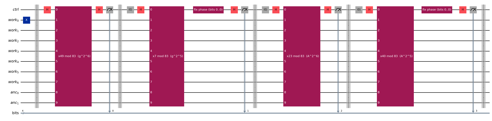

10 qubits: 1 control, 7 work, 2 helper ancillas. The work register only holds powers of 3, so other patterns are "don't care". The circuit has about 2.5 times tier 8's gates because it estimates two phases (14 rounds against 10).

### Measurement result and key extraction
Example shots: (3, 43) gives s = 1, s·a = 14, so a = 14; (75, 25) gives s = 24, s·a = 8, and 8·24⁻¹ mod 41 = 14. A single shot is right 85% of the time, 4 shots 98%, and 8 or more shots 100%.

### Classical cost for comparison
Brute force: 15 steps (41 worst case). Baby-step giant-step: 10 steps. Pollard rho: 12. All finish in microseconds, a million times faster than our simulation. For a 2048-bit group, index calculus (about 2^(n^(1/3))) is out of reach, and for elliptic curves Pollard rho (about 2^(n/2)) is, while Shor needs polynomially many gates. Grover over the exponent needs 15 qubits and 49,698 two-qubit gates, 3.8 times Shor's and barely better than brute force in queries.

---

## Scaling

What changes between these toy sizes and real key sizes:

| Problem | What we ran | At a real size |
|---|---|---|
| Factoring (tiers 8, 9) | N = 35 and 77, 9 to 10 qubits, 5,000 to 24,000 two-qubit gates | RSA-2048 needs thousands of error-corrected qubits and billions of gates. Published estimates: about 20 million noisy qubits for 8 hours (Gidney and Ekerå, 2019) and fewer than 1 million noisy qubits in under a week (Gidney, 2025) |
| Discrete log (tier 10) | Group of order 41, 13,157 two-qubit gates | A few thousand error-corrected qubits for 2048-bit groups or 256-bit elliptic curves (about 2,330 logical qubits for 256-bit curves, Roetteler et al., 2017) |
| Key search (tiers 5, 6) | 10 and 14 bit keys, 25 and 12 rounds | A square-root gain only: a 128-bit key needs about 2^64 Grover rounds of a much larger oracle |
| Query problems (tiers 1, 3, 4) | 24 bits, 6 bits, 10 bits | Bernstein-Vazirani stays at 1 query against n. Deutsch-Jozsa gives an exponential gap only for exact answers. Simon's gap is exponential even with a small error (about 66 runs against 5 × 10^9 queries at n = 64) |
| Phase estimation (tier 7) | 14 bits, 2 qubits | Needs about n rounds, but U^(2^j) must be built cheaply, as in Shor's modular multiplication |
| Key exchange (tier 2) | 1,024 qubits per link, ideal devices | Real links are noisy without an eavesdropper, so key distillation needs error correction and privacy amplification, and the error threshold is about 11% |

**Our toy constructions.** In tiers 8, 9 and 10, each controlled multiplier is built from a lookup table of all values (a chain of swaps). That is O(N) classical work to build, more than factoring 77 by hand, and its gate count grows like N, so it cannot reach n = 2048. A scalable circuit builds the multiplier from modular adders, about n² gates and 2n + 3 qubits. Tiers 5 and 6 build the oracle from the cipher's equations, which is the same kind of preparation. At every size we ran, a classical computer was faster than simulating the circuit (0.06 s to microseconds against seconds). What the circuits show is the mechanism and how the cost grows.

**Hardware needed.** Our circuits range from 2 to 24,000 two-qubit gates. Gates above a few hundred need error correction (next section), so the real-size versions need fault-tolerant machines.

## Hardware or noise

**Real hardware run (tier 7).** We ran the phase-kickback circuit on IBM's `ibm_kingston` (open plan), job `dbr1upujjaos73ai5tl0`, on 2026-11-12. The job held 28 circuits: each of the 14 powers of U read in the X and in the Y basis, 1,024 shots each, 2 two-qubit gates per circuit after transpiling for the device. All 14 bits came out correct (k = 13,383) and the line matches the hash. The contrast (1 means perfect) was 0.97 on average and 0.92 at worst. Raw results are in `tier07/hardware_result.json`, and the plot is `tier07/diagram_hardware.png`.

The hardware run is a variant of the scored circuit. The scored solution feeds each measured bit into the next circuit, which on a shared device would mean 14 jobs in the queue. On the device we read each round twice (X and Y), which gives the direction of the kicked-back phase as a point on a circle, and do the bit-by-bit correction in software, so everything fits in one job. The eigenstate, the controlled U and the phase kickback are the same. The scored `solve()` still runs on Aer.

**Noise simulations (Aer, depolarizing error after every two-qubit gate).** The rule we found: a circuit survives while error rate × number of two-qubit gates stays well below 1.

| Tier | 0.01% per gate | 0.1% per gate (about today's devices) | Notes |
|---|---|---|---|
| 1 (143 gates) | not run | 86% of single shots; majority vote of 101 shots right at every rate we tried | cheap mitigation by voting bit by bit |
| 4 (183 gates) | strict GF(2) solve fails | majority-vote decoder 100% up to 3% per gate | a single wrong equation breaks a strict solve |
| 5 (4,750 gates) | key found in 70% of runs | 5% | needs error rates below about 2 × 10^-4 |
| 6 (2,064 gates) | 90% of shots are passing keys | 14% (random guessing gives 0.4%) | works below about 5 × 10^-4 per gate |
| 7 (2 gates per round) | 100% | 100% (textbook, 230 gates: 83.7%) | iterative version holds to 3% per gate; textbook falls to 17% at 1% |
| 8 (5,053 gates) | 82% of shots on a peak | 13% (random is 2.7%); 8 shots still find the factors 64% of the time | |
| 10 (13,157 gates) | 30% of shot votes right; 16 shots find a in 95% of runs | 0% | Grover column in `tier10/EXPLAINED.md` is an analytic estimate, not a simulation |

At 0.1% per gate, tiers 5 and above are mostly scrambled. Tier 9 with 24,000 gates would have about 24 errors per run. The small circuits (tiers 1, 2, 4, 7) tolerate noise because they have few gates, or can vote over many shots. We did not run zero-noise extrapolation or probabilistic error cancellation.

## Reproducing our numbers

- Official numbers: copy this folder to `submissions/Cryptographers/` in the challenge repo and run `python tools/check_submission.py submissions/Cryptographers`.
- `tierNN/explore.py` produces the comparisons in each section (printed output saved as `explore_output.txt`). `tierNN/benchmark.json` and `BENCHMARKS.md` hold the same numbers in one table. Experiments use our own test oracles or simulated links where the real one may be used only once.
- Slide figures are produced by `slides/make_figures.py` from our own `solution.py` files.
