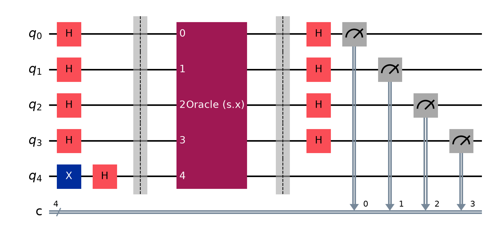

# Tier 1: The Parity Vault, explained simply

**Answer:** `QC-01: Meet at the Oval when the clock reads 6:47`
**Key (hidden string s):** `110001111100110101001001` (24 bits, qubit 23 first)
**Method:** Bernstein-Vazirani, 1 circuit, 1 oracle call.
**Checker:** answer matches the hash, circuit run on Aer (`--metrics-only` run: 143 two-qubit gates, depth 44, 290 gates, 25 qubits).

Files in this folder:

| File | What it is |
|---|---|
| `solution.py` | The submitted solution (what the checker runs) |
| `explore.py` | Experiments comparing classical and quantum methods, on our own test oracles |
| `explore_output.txt` | What `explore.py` printed |
| `benchmark.json` | Numbers for the comparison (success rate, queries, gates, noise) |
| `diagram_bernstein_vazirani.png` | The circuit (drawn for 4 bits; the real one has 24) |

---

## 1. What the file hid, and how we picked the method

- The message is XORed with a repeating 3-byte key, which is the 24-bit string s.
- The vault is a black box that answers one kind of question: give it x, it replies with the parity `s.x mod 2` (the XOR of the bits of s where x has a 1).
- Asked classically, every question returns one bit, so 24 bits need 24 questions. We may ask **one**.

"A hidden string behind a parity oracle, one question" is the textbook setting of the **Bernstein-Vazirani algorithm**. Hint 1 ("ask about every x at once") and hint 2 (target in |->, signs) described it step by step.

## 2. Why it works (beginner version)

The oracle gives each input `x` a **+ or - sign**: `+` if `s.x` is 0, `-` if it is 1.

1. **Target qubit in |->** (X then H). This is **phase kickback**: the oracle's flip of the target shows up as a - sign on the input instead.
2. **H on the 24 inputs**: now all 2^24 values of x are present at once, all with sign +.
3. **One oracle call** stamps the sign `(-1)^(s.x)` on every x in that single call.
4. **H on the inputs again**: the sign pattern `(-1)^(s.x)` is exactly what H turns `|s>` into, so this second H maps the pattern back to the basis state `|s>`. The inputs now hold s. Measuring them gives s with probability 1.

No guessing and no statistics: the answer is exact, so one shot is enough. We used 16 shots as evidence, and all 16 gave the same string.

## 3. Circuit

| | Count |
|---|---|
| Qubits | 25 (24 inputs + 1 target) |
| Our gates | 1 X + 25 H before, 24 H after, **0 two-qubit gates** |
| Oracle calls | 1 |
| Scored circuit (checker, incl. the provided oracle) | 143 two-qubit gates, depth 44, 290 gates, 25 active qubits |

Note: our own part is 50 single-qubit gates (1 X + 25 H + 24 H). Almost all of the 143 two-qubit gates belong to the provided oracle, the same for every team.

## 4. Measurement result and key

| Shots | Outcomes | Result |
|---|---|---|
| 16 | `110001111100110101001001` 16 times | s |

Qiskit prints the classical bits with bit 23 on the left. `s = int(outcome, 2)`, then `s.to_bytes(3, "big")` gives the three key bytes, and `xor_repeating(ciphertext, key)` gives the line.

## 5. Different approaches we tried (`explore.py`)

All of these ran on **our own** test oracles (a secret string we chose, one CX per 1 bit), because the real oracle may be used once.

| Approach | Questions | Always right? | Result |
|---|---|---|---|
| A. Classical, one bit per question (x = 1, 2, 4, ...) | **24** | yes | exact, but 24 oracle calls |
| B. Classical, random questions + solving the equations | 25.7 on average (24 to 33) | yes | never below 24, random questions waste a few |
| C. Classical brute force over all 2^n strings | n + 8 answers, 2^n candidates | yes | n=20: 0.4 s; n=24: about 6 s; n=48: about 5 years |
| D. **Bernstein-Vazirani** | **1** | **yes** | 100/100 shots right |
| E. Quantum, but target left in \|0> (no kickback) | 1 | **no** | right only 50% of the time (the other half reads all zeros) |

So the quantum win is in **questions**, not in time: brute force with a computer is fast at 24 bits, but its work doubles with every bit while BV stays at 1 question.

## 6. Classical cost compared with quantum

| | Oracle calls | Other work |
|---|---|---|
| Classical, one bit at a time | 24 (n) | 24 trivial circuits |
| Classical, brute force | at least n | 2^n candidates (about 6 s at 24 bits, years at 48) |
| Bernstein-Vazirani | **1** | 49 H/X gates, one Hadamard-transform readout |

For n bits the classical question count is n, always; BV stays at 1. That is a linear gap in questions. (Deutsch-Jozsa, tier 3, has an exponential gap for exact answers; Bernstein-Vazirani only a linear one.)

## 7. Noise (from `explore.py` part F, and the real oracle)

We added random errors after every two-qubit gate. Our test oracle (13 CX) and the real one (159 CX in our basis, 143 after the checker's transpile) both stay readable:

| Error per CX gate | Test oracle, one-shot exact | Real oracle, one-shot exact | Majority vote of 101 shots |
|---|---|---|---|
| 0 | 1.00 | 1.00 | right |
| 0.001 (today's hardware) | 0.96 | 0.86 | right |
| 0.005 | 0.94 | 0.50 | right |
| 0.01 | 0.87 | 0.28 | right |
| 0.02 | 0.77 | 0.12 | right |
| 0.1 | 0.30 | not run | wrong on the test oracle |

A noisy gate flips a few output bits; the same bit rarely flips in most shots, so a **majority vote bit by bit** recovers s even when one shot is wrong. This is a cheap mitigation; the circuit is small, so we did not use ZNE or PEC.

## 8. What changes at real size

- Our gates grow as 3n + 2 and the oracle has about n/2 CX for a random s, so BV stays cheap in gates.
- A real device would add noise per gate, but majority voting works until the per-bit error nears 50%.
- A quantum simulator needs memory 2^n in general; this circuit is made of H, X and CX only, which is why a simulator could do n = 64.
