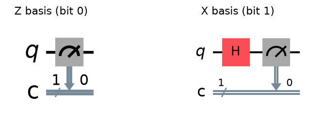

# Tier 2: Two Links, explained simply

**Answer:** `QC-02: bring 3 buckeyes, a blue pen`
**Method:** BB84 quantum key distribution, with random bases and a public check.
**Clean link:** `link_A` (QBER 0%). **Tapped link:** `link_B` (QBER 20.8%).
**Checker:** answer matches the hash in `common.is_correct`; every qubit measured once.

Files in this folder:

| File | What it is |
|---|---|
| `solution.py` | The submitted solution (what the checker runs) |
| `explore.py` | Experiments on our own simulated links (the real links can be measured only once) |
| `explore_output.txt` | What `explore.py` printed |
| `diagram_bb84.png` | The two measurement circuits |

---

## 1. What the file hid, and how we picked the method

- The message is XORed with a key. The key was rebuilt from qubits Alice sent to Bob, so the key exists only if we measure them.
- Alice sent each qubit in a **random basis** (Z or X). Eve sits on one of two links and measures and resends every qubit.
- "Qubits in random bases, an eavesdropper, find the clean link, build a key" is **BB84**. The README hints ("keep a bit only if your basis matched", "compare with the check set") spell out its steps.

## 2. Why it works (beginner version)

A qubit prepared in Z holds a definite 0 or 1 if you measure in Z. If you measure it in X instead, you get a **coin flip**. The same holds the other way round.

1. **We pick a random basis for every qubit**, before we know Alice's. Z: measure directly. X: put an H gate first, then measure.
2. **Alice then tells us her bases.** Where ours matched (about half), our bit equals hers. Where not, our bit is a coin flip. We throw those away ("sifting").
3. **Eve is caught by the check set.** She guesses a basis too. Half the time she guesses wrong, and then the qubit she resends is a coin flip in Alice's basis, so our bit is wrong half of those times: 1/2 x 1/2 = **25% errors**. Alice reveals about a quarter of her bits publicly, and we count the disagreements.
4. **Clean link = no disagreements.** We drop the public check bits (anyone saw them) and feed the other sifted bits to `reconcile()`, which gives the key.

| Link | Matching-basis check bits | Disagreements | QBER |
|---|---|---|---|
| `link_A` | 143 | 0 | **0.0%** (clean) |
| `link_B` | 125 | 26 | **20.8%** (tapped; the expected 25% shows up with sampling noise) |

## 3. Circuit

| | Count |
|---|---|
| Qubits per circuit | 1 (one circuit per received qubit) |
| Gates | Z basis: 0 gates. X basis: 1 H gate. 0 two-qubit gates |
| Circuits run | 2048 (1024 per link), each measured once |

The scored circuit (checker, after transpiling) is the X-basis one: 1 qubit, 0 two-qubit gates, 3 gates, depth 3 (the checker breaks the H into three basic rotations). A measurement circuit cannot get much smaller.

## 4. Measurement result and key

- `link_A`: 383 sifted, non-check bits. The key is 280 bits, and `reconcile()` solves linear equations over GF(2), so 383 bits for 280 unknowns is enough.
- `link_B` gives a wrong key, which decrypts to garbage.
- Result: `QC-02: bring 3 buckeyes, a blue pen`.

## 5. Different approaches we tried (`explore.py`)

All of these ran on **our own** simulated links (Alice, optional Eve, Bob, on Aer).

| Approach | Clean link | Tapped link | Verdict |
|---|---|---|---|
| A. **BB84, Bob picks random bases**, sift, check | QBER 0% | QBER 25.8% | works, textbook |
| B. Bob always measures in Z | QBER 0% | QBER 25.0% | also works here, since Alice's bases are already random; but it drops the "Bob is unpredictable" part of BB84 |
| C. No sifting (use every bit) | 25% of bits wrong | n/a | **fails**: the key is garbage even without Eve |
| D. Eve taps only a fraction f | QBER = 25% x f | | the more she taps, the easier she is to catch |
| E. Noise instead of Eve (depolarizing p) | p=0.02: 0.4%, p=0.1: 9.4% | | real devices need a QBER **threshold**, not zero |

How many check bits we need: if Eve taps every qubit, a check of k bits misses her with probability (3/4)^k. For k = 10 that is 5.6%, for k = 20 0.3%, for k = 50 about 0. We had 125 to 143.

## 6. Classical cost compared with quantum

- **Classical**: a classical bit can be copied. An eavesdropper reads it, copies it, forwards it, and nobody notices. A classical channel cannot detect a tap. Security has to come from math assumptions (e.g. RSA, tiers 8 to 10).
- **Quantum**: measuring an unknown qubit in the wrong basis changes it (and no-cloning forbids copying). So the tap itself leaves a mark of 25% errors. The security rests on physics, not on a hard problem.
- **Cost**: 1024 qubits per link for about 280 key bits (efficiency about 27%: half lost to sifting, a quarter to the check, the rest to reconcile).
- Classical post-processing here is small: sifting, an error count, and one GF(2) solve.

## 7. What changes at real size

- A real link has noise even without Eve, so error correction and **privacy amplification** are needed, and the threshold is about 11% QBER.
- Real BB84 needs single-photon sources and detectors, and fibre loss limits the distance to a few hundred kilometres without quantum repeaters.
