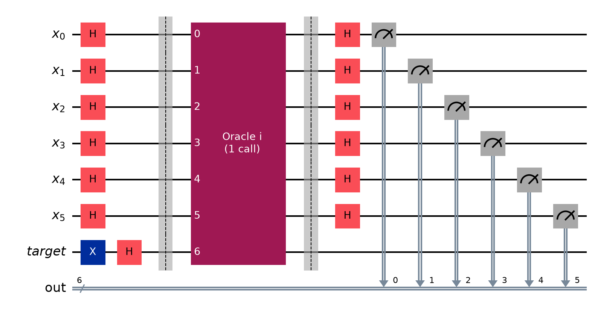

# Tier 3: Twenty-Four Seals, explained simply

**Answer:** `QC-03: Mirror Lake hides a brass key by the northeast rock`
**Key:** `110010110010100010000000` (24 bits, oracle 0 first)
**Method:** Deutsch–Jozsa, 24 circuits, 1 oracle call each.
**Checker:** full match, circuit run on Aer.

Files in this folder:

| File | What it is |
|---|---|
| `solution.py` | The submitted solution (what the checker runs) |
| `explore.py` | Experiments comparing classical and quantum methods, on our own test oracles |
| `explore_output.txt` | What `explore.py` printed |
| `diagram_deutsch_jozsa.png` | The circuit |

---

## 1. What the file hid, and how we picked the method

- The message is locked with a 24-bit key.
- Each key bit is hidden in a "seal": a black-box function `f(x)` on 6 input bits (64 possible inputs).
- We are **promised** each `f` is one of two kinds:
  - **constant**: the same answer for all 64 inputs, so key bit = 0
  - **balanced**: answer 1 on exactly 32 inputs and 0 on the other 32, so key bit = 1
- We may ask each seal **only one question**.

"Constant or balanced, with a promise, one question" is the textbook setting of the **Deutsch–Jozsa algorithm**. The README hint ("a question about all 64 inputs at once") pointed the same way.

## 2. Why it works (beginner version)

Think of the oracle as a machine that, for each input `x`, stamps a **+ or − sign** on it: `+` if `f(x)=0`, `−` if `f(x)=1`.

1. **Target qubit in |−⟩** (X then H). This is a trick called **phase kickback**: when the oracle "flips" this target, the target looks unchanged, and the flip shows up as a **− sign** on the input instead.
2. **H on the 6 inputs**: now the inputs hold all 64 values at once, all with sign `+`.
3. **One oracle call** stamps a sign on all 64 values in that single call.
4. **H on the inputs again**: this "adds up" all the signs into the `000000` outcome:
   - **constant**: all signs equal, so they add up fully and we **always** measure `000000`
   - **balanced**: 32 `+` and 32 `−` cancel exactly, so we **never** measure `000000`

In one formula: `P(000000) = ( average of (−1)^f(x) )²`, which is 1 for constant and 0 for balanced.
The answer is exact, not probabilistic, so **one shot is enough**. We used 16 shots per seal as evidence.

## 3. Circuit

| | Count |
|---|---|
| Qubits | 7 (6 inputs + 1 target) |
| Our gates | 1 X + 7 H before, 6 H after, **0 two-qubit gates** |
| Oracle calls | 1 per circuit, 24 circuits |
| Scored circuit (checker, incl. the provided oracle) | 7808 two-qubit gates, depth 8771, 19497 gates, 7 active qubits |

Almost all of the scored size is the provided oracle, which is the same for every team. Our part is 14 single-qubit gates, the minimum Deutsch–Jozsa needs.

## 4. Measurement result and key

| Oracle | Counts (16 shots) | Kind | Bit |
|---|---|---|---|
| 0, 1, 4, 6, 7, 10, 12, 16 | spread over many non-zero strings, **never** `000000` | balanced | 1 |
| 2, 3, 5, 8, 9, 11, 13–15, 17–23 | `000000`: 16/16 | constant | 0 |

Reading oracle 0 to 23 gives `110010110010100010000000`. Then `keystream(key, length)` XOR the ciphertext gives the line.

## 5. Different approaches we tried (`explore.py`)

All of these ran on **our own** test oracles, because each real oracle may only be used once.

| Approach | Questions per seal | Always right? | Result |
|---|---|---|---|
| A. Classical, ask one input at a time | up to **33** (2⁵ + 1) | yes, but only after 33 | the "sneaky" oracle (0 on the first 32 inputs) needs all 33 |
| B. Classical, random guessing with k questions | k | no, wrong ≈ 2^−(k−1) | k = 10 is still wrong 0.1% of the time |
| C. Quantum, but target left in \|0⟩ | 1 | **no** | balanced gives P(000000) ≈ 0.5: no phase kickback, so the answer hides in the unmeasured target |
| D. **Deutsch–Jozsa** | **1** | **yes** | P(000000) = 1.00 or 0.00 exactly |

Bonus: when `f(x)` is a parity like `x1 ⊕ x3 ⊕ x5`, the same circuit outputs exactly `101010`, which names the bits. That is the **Bernstein–Vazirani** algorithm (the tier 1 trick), so tier 1 and tier 3 are the same circuit.

## 6. Classical cost compared with quantum

| | Per seal | All 24 seals |
|---|---|---|
| Classical, certain | 33 questions (worst case) | 792 questions |
| Classical, 99.9% sure | ~11 random questions | ~264 questions |
| Deutsch–Jozsa | **1 question** | **24 questions** |

For n input bits the classical certain cost is 2^(n−1) + 1, which grows exponentially. Deutsch–Jozsa always needs one question. That is an exponential gap, but **only for exact answers**: allowing a tiny error, classical random guessing also needs only a few questions. So Deutsch–Jozsa is a teaching example more than a practical speed-up.

## 7. Noise (from `explore.py`, part E)

We added random errors after every two-qubit gate to a test oracle about as large as the real ones (7680 CX):

| Error per CX gate | Constant: P(000000) | Balanced: P(000000) |
|---|---|---|
| 0 | 1.00 | 0.00 |
| 0.0001 | 0.52 | 0.01 |
| 0.001 (today's hardware) | 0.02 | 0.02 (cannot tell apart) |

With ~7800 CX gates, today's hardware would scramble the answer. The algorithm is one question, but the question itself (the oracle) is big. Real hardware needs either much smaller oracles or error correction.
