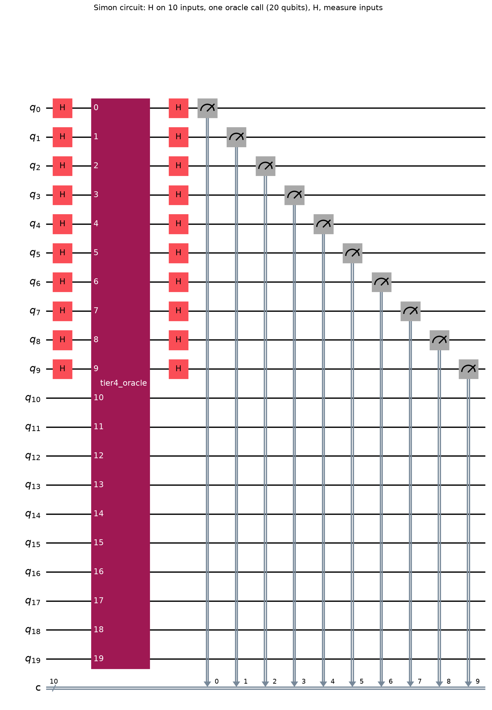

# Tier 4: The Echo, explained simply

**Answer:** `QC-04: Brutus will whistle Carmen Ohio slightly off-key`
**Key:** `s = 1100011000` (10 bits, bit j = qubit j)
**Method:** Simon's algorithm: 1 oracle call per run, about 11 runs, then a GF(2) solve.
**Checker:** answer matches the hash; circuit ran on Aer (179 two-qubit gates, depth 195, 451 gates, 20 qubits).

Files in this folder:

| File | What it is |
|---|---|
| `solution.py` | The submitted solution (what the checker runs) |
| `explore.py` | Experiments comparing classical and quantum methods |
| `explore_output.txt` | What `explore.py` printed |
| `benchmark.json` | Per-method metrics (success, calls, time, gates, depth, noise) |
| `diagram_simon.png` | The circuit |

---

## 1. What the file hid, and how we picked the method

- The message is locked with a 10-bit key `s`.
- `s` is hidden in a function `f` on 10 bits that is exactly **2-to-1** with `f(x) = f(x XOR s)`: every answer appears for two inputs, `x` and `x XOR s`.
- Finding a repeated answer by asking questions one input at a time is a birthday search, about 2^(n/2) questions. The README says a quantum circuit needs about n runs.

"Hidden XOR repeat of a 2-to-1 function" is exactly **Simon's problem**, and hint 1 ("query every x at once") and hint 2 (Hadamards turn each run into one linear equation mod 2) describe its steps.

## 2. Why it works (beginner version)

1. **H on the 10 inputs**: all 1024 values of `x` at once.
2. **One oracle call**: each `x` is now stored next to its answer `f(x)`.
3. Because `x` and `x XOR s` give the same answer, the inputs are tied together in pairs `{x, x XOR s}`.
4. **H on the inputs again, then measure.** The two members of each pair interfere. Only outcomes `y` with **y · s = 0 (mod 2)** survive; all others cancel.

So every run gives a random `y` and one equation `y · s = 0`. About 9 independent equations leave exactly one non-zero `s`. We solve them with Gaussian elimination over GF(2) (XOR the rows, no division needed).

## 3. Circuit

| | Count |
|---|---|
| Qubits | 20 (10 inputs + 10 outputs) |
| Our gates | 10 H before, 10 H after, **0 two-qubit gates** |
| Oracle calls | 1 per run, 40 runs (shots) |
| Scored circuit (checker, incl. the provided oracle) | 179 two-qubit gates, depth 195, 451 gates, 20 active qubits |

Almost all of the scored size is the provided oracle (the same for every team). Our part is the 20 single-qubit H gates.

## 4. Measurement result and key

- First runs gave strings such as `0010111100`, `1011010000`, `1000101000`. Each one satisfies `y · s = 0`.
- 40 runs gave about 37 distinct `y`; the elimination leaves a null space of dimension 1: `s = 1100011000`.
- `key_bits = format(s, "010b")`, then `keystream(key_bits, length)` XOR the ciphertext gives the line.

## 5. Different approaches we tried (`explore.py`, `benchmark.json`)

Classical methods only ask the oracle questions `x -> f(x)` (comparison-only, never used by `solution.py`). Quantum ones measure the oracle as the tier allows.

| Approach | Oracle calls | Success | Time (Aer) | Two-qubit gates, depth |
|---|---|---|---|---|
| A. Classical brute force, ask all 1024 inputs | 1024 | 100% (deterministic) | 8 s | 183, 193 per query |
| B. Classical birthday search, random order | mean **40**, worst seen 122 | 100% when done; 39% within 32 queries, 87% within 64 | 0.8 s | 183, 193 per query |
| C. **Simon + GF(2) elimination** (submitted) | mean **10.7** runs | 100% with 40 runs | 0.3 s | 183, 195 |
| D. Simon + majority vote (noise-tolerant decoder) | 200 runs | 100% ideal | 0.2 s | 183, 195 |
| E. Simon, output register measured first (hint 1) | 60 runs | 100% | 0.5 s | 183, 196 |
| F. Grover search for `s`, using the oracle twice per round | 35 calls | 100% (P(s) = P(0) = 0.5) | 12 s | **7310**, 12095 |

Notes:
- **Sequential scan** (x = 0, 1, 2, ...) finds a collision at x = 2^(top bit of s): 513 queries here, since `s` has top bit 9. The worst case is 2^(n−1) + 1 = 513.
- **Simon: how many runs?** With k runs the chance that the k equations pin `s` down is about 29% at k = 9, 58% at k = 10, 89% at k = 12 and 98% at k = 15 (measured, matching theory). Fewer than 9 can never work.
- **E (output measured first)** gives the same equations; it only makes the picture easier to explain.
- **F (Grover)** marks inputs with `f(x) = f(0)` (these are `x = 0` and `x = s`) and amplifies them, using about √N rounds. It works but is about 40 times bigger than Simon, and it gains only a quadratic speed-up, not Simon's exponential one.

## 6. Classical cost compared with quantum

| | Calls | Notes |
|---|---|---|
| Classical, certain | 2^(n−1) + 1 = 513 (n = 10) | worst case |
| Classical, birthday | about √(π · 2^n / 2) = 40 | random, no guarantee |
| Simon | about n + 1 = 11 | each run is one oracle call |

Measured scaling on small oracles we built ourselves (mean over 5 random `s`):

| n | Simon runs | Classical queries (birthday) | Classical worst case |
|---|---|---|---|
| 5 | 7.0 | 7.2 | 17 |
| 8 | 7.8 | 19.9 | 129 |
| 11 | 10.2 | 57.0 | 1025 |

Extrapolated: n = 64 needs about 66 Simon runs against about 5 × 10^9 classical queries, and n = 128 needs about 130 runs against about 2 × 10^19. This is an exponential gap, and unlike tier 3 it holds even if we accept a small error. The catch is that every run needs an oracle of size growing with n, and that oracle is where the gates are.

## 7. Noise (from `explore.py`, part D)

Depolarizing error after every two-qubit gate (183 of them), 5 trials of 200 runs each:

| Error per CX gate | Strict GF(2) solve | Majority vote |
|---|---|---|
| 0 | 100% | 100% |
| 0.0001 to 0.03 | 0% | 100% |
| 0.1 | 0% | 0% |

The strict solve breaks at the first wrong `y`: one bad equation can rule out the true `s`, and even 0.0001 puts a few wrong equations into 200 runs. Voting scores every candidate `s` by how many runs satisfy `y · s = 0` and takes the best, so the true `s` only has to win a majority. It survives up to 3% error per gate. Today's hardware is around 0.1% to 1%, so this decoder would work, which is a good argument for doing the post-processing statistically on real devices.
