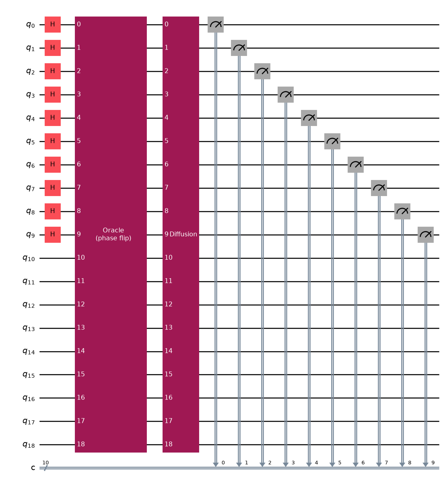
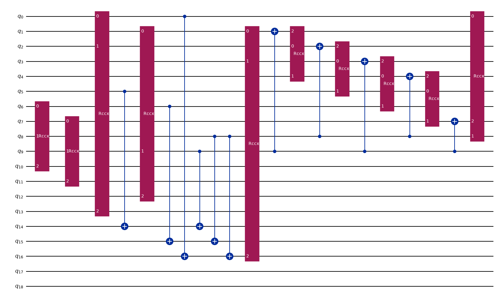

# Tier 5: The Small Safe, explained simply

**Answer:** `QC-05: count the lamps on the Long Walk: there are nineteen`
**Key:** 263 (10 bits)
**Method:** Grover search, 25 rounds, with an oracle we built from the cipher's gates.
**Checker:** answer matches the hash; circuit run on Aer (19 qubits, 4750 two-qubit gates, depth 4960).

Files in this folder:

| File | What it is |
|---|---|
| `solution.py` | The submitted solution (what the checker runs) |
| `explore.py` | Experiments: classical brute force, Grover curves, oracle builds, noise, scaling |
| `explore_output.txt` | What `explore.py` printed |
| `benchmark.json` | Benchmark rows (success, oracle calls, time, qubits, gates, depth, noise) |
| `diagram_grover.png` | Grover circuit as blocks (H, oracle, diffusion, measure) |
| `diagram_oracle.png` | What is inside the oracle (the CX and Toffoli gates that check the key) |

---

## 1. What the file hid, and how we picked the method

- The message is encrypted by a toy byte cipher with a **10-bit key**: 1024 possible keys.
- We know the line starts `QC-05:`. A wrong key decrypts to garbage, so "decrypts to `QC`" is a yes/no test on a key.
- The README says we must build that test as a **reversible circuit** (the oracle) and let a quantum circuit find the key.
- "Search a list for the one item that passes a yes/no test" is **Grover search**. The README hint ("mark with a minus sign, reflect, repeat about (pi/4) sqrt(N) times") says the same.
- One byte is not enough: 4 keys decrypt the first byte to `Q`. Two bytes (`QC`) leave exactly one key. So the oracle checks both.

## 2. Why it works (beginner version)

1. **Put the key register in an equal mix of all 1024 keys** (H on 10 qubits). Each key has the same small chance, 1/1024.
2. **Oracle:** run the "does this key decrypt `QC`?" test on all keys at once. Where the test passes, flip the sign (a minus sign) of that key. Then undo the test so nothing else is left behind.
3. **Diffusion (reflection about the average):** a minus sign alone changes no measurement chance. Reflecting every amplitude about the average makes the flipped key's amplitude **grow** a little and the rest shrink a little.
4. **Repeat.** Each (oracle, diffusion) round turns the state by the angle 2*theta, where sin(theta) = sqrt(1/1024). After about (pi/4) * sqrt(1024) = **25 rounds**, almost all the chance sits on the right key.
5. **Measure** and check the result classically.

Too few rounds and the key is still hidden. **Too many rounds and the state turns past the key and the chance drops again.** That is why the count matters.

## 3. How the oracle is built

Decrypting byte i is: XOR with a key-dependent mask, S-box, permutation. The S-box and permutation do not involve the key, so "byte i decrypts to the known letter" is the same as "the mask equals a known 8-bit constant". Each mask bit is `k[a] XOR k[b] XOR (k[c] AND k[d])`, which is a few CX gates and one Toffoli. Two bytes give 16 such equations. Three tricks cut the size (see `solution.py`):

- **Shared Toffolis:** bytes 0 and 1 use many of the same AND terms, so the second copy becomes a CX-only parity check.
- **In-place evaluation:** an equation can be written onto one of its own key qubits, so it needs no scratch qubit.
- **Relative-phase Toffolis (RCCX, 3 CX instead of 6):** the extra phases cancel, since the oracle is W^-1 Z W with Z diagonal.

| | Count |
|---|---|
| Qubits | 19 (10 key + 7 scratch + 2 clean helpers for the multi-controlled Z) |
| Grover rounds | 25 |
| Scored circuit (checker) | 4750 two-qubit gates, depth 4960, 14588 gates, 19 qubits |
| Per round | 190 CX |

## 4. Measurement result and key

The 25-round circuit measures key 263 in 100% of the shots on Aer (2000 shots). `solve()` decrypts the measured keys, most frequent first, and keeps the one whose plaintext starts with `QC-05:`. Result: `QC-05: count the lamps on the Long Walk: there are nineteen`.

## 5. Different approaches we tried (`explore.py`)

| Approach | Oracle uses / trials | Success | Wall time | Notes |
|---|---|---|---|---|
| A. Classical brute force, all keys (comparison only) | 1024 | 100% | 10 ms | trivial at 10 bits |
| B. Classical, stop at the first hit | 264 here (about 512 on average) | 100% | 3 ms | in numeric order the key 263 is found after 264 tries |
| C. **Grover, 25 rounds (submitted)** | **25** | **100%** | 2.5 s (end to end, incl. compile) | 19 qubits, 4750 CX |
| Grover, 10 rounds | 10 | 38% | | too few |
| Grover, 40 rounds | 40 | 34% | | too many |
| Grover, 50 rounds | 50 | 0% | | the state has turned past the key |
| D. Oracle, plain Toffoli (6 CX) instead of RCCX | 25 | 100% | | 6250 CX (+32%), depth 6112 |
| D. Oracle, raw equations (no shared Toffolis) | 25 | 100% | | 21 qubits, 6950 CX (+46%), depth 9531 |
| E. Grover with random rounds (BBHT, number of marked keys not needed) | 51 on average | 100% | | about 2x the best fixed count |

Success against the number of rounds follows `sin^2((2k+1)*theta)` closely (Aer 1.000 vs theory 0.999 at k = 25).

At 10 bits the classical search is faster in wall-clock time (10 ms against seconds): simulating a quantum circuit on a classical computer costs more than checking 1024 keys. The comparison is about **how the cost grows**, not about this size.

## 6. Classical cost compared with quantum

| Key bits | Classical (average) | Grover rounds | CX if each round costs 190 |
|---|---|---|---|
| 10 | 512 | 25 | 4.8e3 |
| 14 | 8.2e3 | 101 | 1.9e4 |
| 32 | 2.1e9 | 5.2e4 | 9.8e6 |
| 64 | 9.2e18 | 3.4e9 | 6.4e11 |
| 128 | 1.7e38 | 1.5e19 | 2.8e21 |

(The per-round cost is a rough guess: a real oracle for a bigger key would be larger.) Grover gives a **square-root** speed-up, not an exponential one: a 128-bit key still needs about 2^64 rounds. That is why doubling the key length is the standard defence against quantum search.

## 7. Noise (`explore.py`, part F)

Random errors (depolarizing) after every CX, 40 noisy runs per setting, on the submitted circuit:

| Error per CX | Key found |
|---|---|
| 1e-5 | 98% |
| 1e-4 | 70% |
| 1e-3 (about today's devices) | 5% |

The rule of thumb is error rate x number of CX well below 1. With 4750 CX that means errors below about 2e-4. The circuit works on a simulator, but real hardware needs better gates or error correction. Error suppression (dynamical decoupling) or mitigation (zero-noise extrapolation) could help partway, but we did not run them.

## 8. Benchmark summary

The numbers behind these tables are in `benchmark.json` (success, oracle uses, time, qubits, 2Q gates, depth, noisy success). The first printed run of `explore.py` measured a 52 s "time to solution" because other jobs loaded the machine; run alone, `solve()` takes about 2.5 s.
