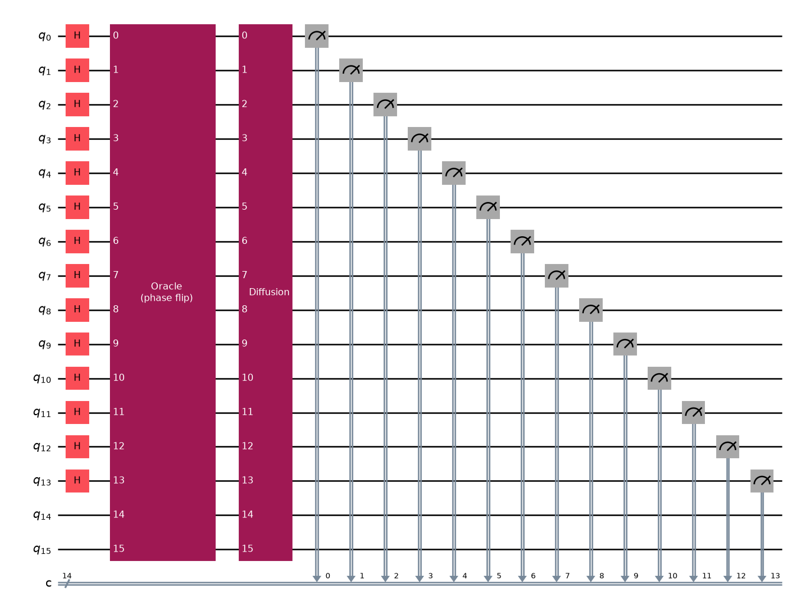
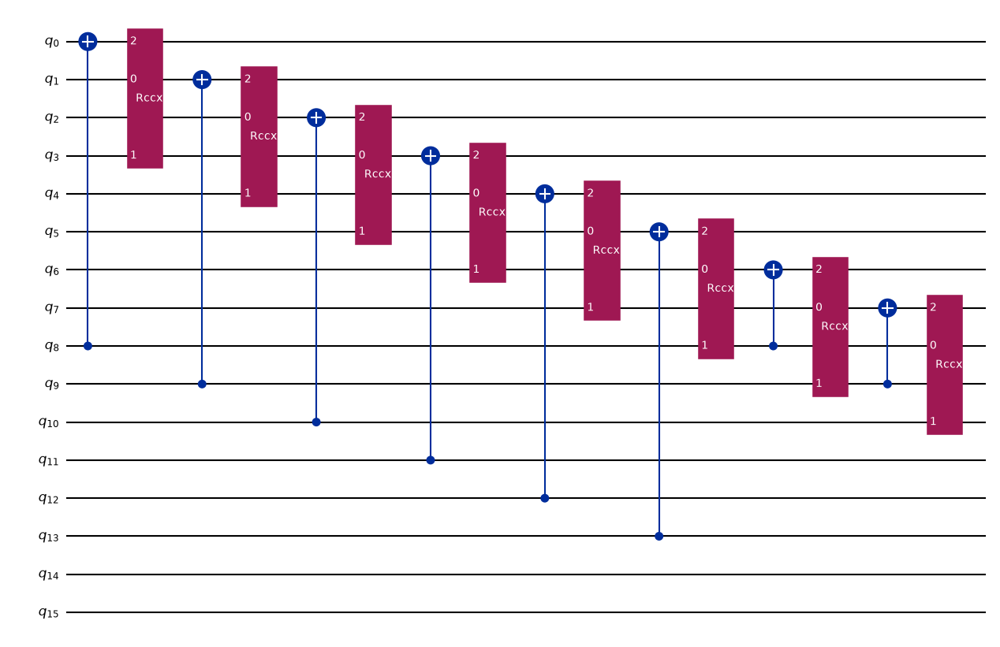

# Tier 6: The Bigger Safe, explained simply

**Answer:** `QC-06: the Thompson Library elevator stops twice on floor 8`
**Key:** 5401 (14 bits)
**Method:** Grover search with **many** marked keys (M = 64), 12 rounds, then a classical checksum filter.
**Checker:** answer matches the hash; circuit run on Aer (16 qubits, 2064 two-qubit gates, depth 2826).

Files in this folder:

| File | What it is |
|---|---|
| `solution.py` | The submitted solution (what the checker runs) |
| `explore.py` | Experiments: classical brute force, Grover curves, wrong-M and unknown-M cases, oracle builds, noise, scaling |
| `explore_output.txt` | What `explore.py` printed |
| `benchmark.json` | Benchmark rows (success, oracle calls, time, qubits, gates, depth, noise) |
| `diagram_grover.png` | Grover circuit as blocks (H, oracle, diffusion, measure) |
| `diagram_oracle.png` | What is inside the oracle |

---

## 1. What the file hid, and how we picked the method

- The same toy byte cipher as tier 5, now with a **14-bit key**: 16384 keys.
- This time we trust **only the first byte, `Q`**. About 64 keys pass that test, so the search has many right answers.
- A public **checksum** (sum of all plaintext bytes mod 256) separates the true key from the 63 decoys.
- "Find an item that passes a yes/no test, there are several" is **Grover search with M marked items**. The README's second hint (the number of repeats is about (pi/4) sqrt(N/M)) points at the same thing.

## 2. Why it works, and what many answers change

Grover rotates the state toward the marked keys by 2*theta per round, where sin(theta) = sqrt(M/N). With more marked keys, theta is bigger, so we need fewer rounds:

| | Tier 5 | Tier 6 |
|---|---|---|
| Keys N | 1024 | 16384 |
| Marked M | 1 | 64 |
| sin(theta) | 1/32 | 1/16 |
| Rounds (pi/4) sqrt(N/M) | 25 | **12** |

**How we know M = 64.** All 8 oracle equations can be written in place onto the key qubits k0..k7, each reading only qubits with a larger index. So the map (k0..k7) to (mask bits) is one-to-one for every choice of k8..k13. Each of the 2^6 = 64 values of k8..k13 therefore has exactly one matching (k0..k7): M = 64. We checked it by brute force too (`explore.py` finds 64).

The circuit **cannot tell the 64 apart**. Each is measured with the same chance, so one shot is a random one of the 64. We run 4096 shots (65 distinct keys appear), decrypt each classically, and keep the key whose full plaintext has the public checksum. Exactly one passes.

## 3. Circuit

| | Count |
|---|---|
| Qubits | 16 (14 key + 2 clean helpers; **no scratch qubits**, everything runs in place) |
| Grover rounds | 12 |
| Scored circuit (checker) | 2064 two-qubit gates, depth 2826, 6948 gates, 16 qubits |
| Per round | 172 CX |
| Oracle | 8 equations: 8 relative-phase Toffolis and CX gates, then a multi-controlled Z, then undo |

## 4. Measurement result and key

12 rounds put 100% of the shots on one of the 64 passing keys (Aer, 4000 shots). Of the 65 distinct keys measured, only key 5401 passes the checksum, and it decrypts to `QC-06: the Thompson Library elevator stops twice on floor 8`. `solve()` raises an error if the filter does not leave exactly one key.

## 5. Different approaches we tried (`explore.py`)

| Approach | Oracle uses / trials | Success | Wall time | Notes |
|---|---|---|---|---|
| A. Classical, full decrypt of every key (comparison only) | 16384 | 100% | 8.2 s | |
| A. Classical, staged (byte 0 first, then checksum on the 64 passers) | 16384 cheap tests | 100% | 0.11 s | a smarter classical attack |
| B. Classical, stop at the first full match | 5402 here (about 8192 on average) | 100% | 0.05 s | |
| C. **Grover, M = 64, 12 rounds (submitted)** | **12** | **100%** that a shot is a passing key | 0.2 s end to end | 16 qubits, 2064 CX |
| Grover, 6 rounds | 6 | 54% | | too few |
| Grover, 24 rounds | 24 | 0.6% | | too many (turned past) |
| D. Grover, rounds for M guessed as 1 | 100 | 0% | | far too many rounds |
| D. Grover, rounds for M guessed as 256 | 6 | 55% | | too few |
| D. Grover, rounds for M guessed as 1024 | 3 | 19% | | too few |
| E. Estimate M from the success curve (k = 1..8) | | M = 66 (true 64) | | fit of sin^2((2k+1) asin(sqrt(M/N))) |
| E. Random rounds (BBHT), M unknown | 27 on average | 100% | | about 2x the best fixed count, needs no M |
| F. Oracle with plain Toffoli | 12 | 100% | | 2592 CX (+26%), depth 3570 |
| F. Oracle trusting 2 bytes `QC` (M = 2) | 71 | 100% | | 21 qubits, 16472 CX (8x), depth 17198 |

**Guessing M wrong** costs success in both directions: a guess that is too small runs too many rounds and turns past the keys, a guess that is too large stops short. M = 66 estimated from the curve is close enough to give 12 rounds again.

**One byte or two:** trusting `QC` leaves only 2 passing keys and nearly removes the filter, but it needs about 6x the rounds and a larger oracle, for 8x the total CX. A big M with a classical filter is much cheaper.

The classical attack here is also quick: 16384 keys is nothing, and the staged version takes about 0.1 s. Simulating quantum circuits on a classical computer costs more than that, so the point is how the cost scales, not this size.

## 6. Classical cost compared with quantum

| Key bits n | Classical (average) | Grover rounds, first-byte oracle |
|---|---|---|
| 14 | 8.2e3 | 12.6 |
| 20 | 5.2e5 | 12.6 |
| 64 | 9.2e18 | 12.6 |
| 128 | 1.7e38 | 12.6 |

Here the 8-bit first-byte test leaves M = 2^(n-8) passing keys, so the number of rounds stays near 12.6 whatever the key size. The cost moves to the classical filter over the M survivors, which grows with n. Trusting more bytes (M closer to 1) brings back the full square-root cost. Grover is a square-root speed-up, not an exponential one.

## 7. Noise (`explore.py`, part G)

Depolarizing error after every CX, 100 noisy runs per setting. "Passing key" means the shot is one of the 64 keys that pass byte 0 (random guessing gives 0.4%).

| Error per CX | Shots that are passing keys |
|---|---|
| 1e-5 | 97% |
| 1e-4 | 90% |
| 1e-3 (about today's devices) | 14% |

With 2064 CX the circuit works while the error is below about 5e-4. The 12-round search is much shorter than tier 5's 25-round one, which tolerates less noise (4750 CX). Fewer marked-key rounds mean a shallower circuit, so a larger M also helps against noise. We did not run error mitigation (ZNE, dynamical decoupling).

## 8. Benchmark summary

The numbers behind these tables are in `benchmark.json`. The first printed run of `explore.py` showed a 13.8 s "time to solution" because other jobs loaded the machine; run alone, `solve()` takes about 0.2 s.
