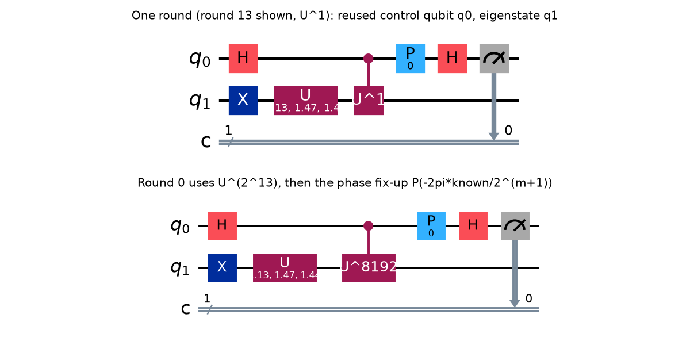
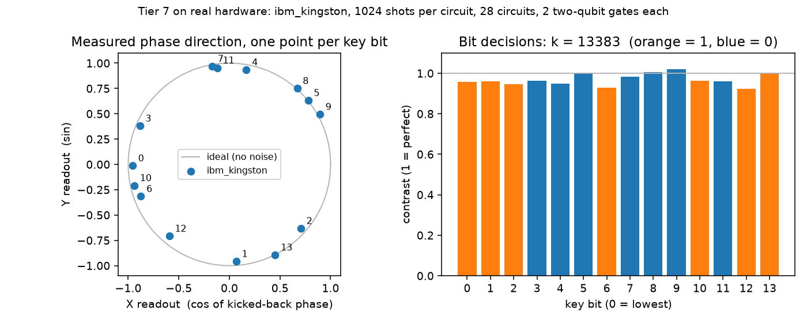

# Tier 7: The Hidden Angle, explained simply

**Answer:** `QC-07: ask the night librarian for Folio 1870-Q, not 1870-R`
**Key:** `11010001000111` (k = 13383, so phi = k / 2^14 = 0.81683...)
**Method:** iterative (semiclassical) quantum phase estimation, 14 rounds on 2 qubits.
**Checker:** answer matches the hash, circuit run on Aer. Scored circuit: 2 qubits, 2 two-qubit gates, depth 11, 16 gates. The checker adds the note "under 8 active qubits"; see section 3.

Files in this folder:

| File | What it is |
|---|---|
| `solution.py` | The submitted solution (what the checker runs) |
| `explore.py` | Comparison of classical and quantum approaches (writes `benchmark.json`) |
| `explore_output.txt` | What `explore.py` printed |
| `benchmark.json` | Per-method numbers: success rate, qubits, gates, depth, time, noise |
| `diagram_iterative_qpe.png` | One round of the circuit |

---

## 1. What the file hid, and how we picked the method

- A one-qubit gate U has two eigenvalues, 1 and e^(2 pi i phi). phi is the key: `phi = k / 2^14`.
- We are given U and the state it leaves alone (its eigenstate), but not the angle.
- "Read a phase out of a unitary, with an exact binary expansion" is **quantum phase estimation**. Hint 2 of the README (a controlled U puts the phase on the control qubit, U applied 2^j times multiplies it by 2^j) describes the same thing.

## 2. Why it works (beginner version)

1. **Phase kickback.** If we use U controlled by a qubit that is in `|0> + |1>`, and the target is the eigenstate, the target does not change at all. Instead the control qubit gets a twist of angle `2 pi phi`.
2. **Powers of U read bits.** Using U^(2^j) twists the control by `2 pi phi 2^j`. Because phi has exactly 14 binary digits, the twist by 2^13 phi is half a turn if the last key bit is 1 and nothing if it is 0. One Hadamard turns "half a turn or nothing" into a definite 1 or 0.
3. **Our shortcut, one control qubit reused 14 times.** Textbook phase estimation uses 14 control qubits and an inverse QFT. We instead measure one bit per round (least significant bit first) and remove the part of the twist caused by the bits we already know with a single phase gate. That is the inverse QFT done "semiclassically".
4. **Exact answer.** After the correction each round is deterministic, so one shot per round is enough. We take 64 shots only for evidence.

How U^(2^j) is built: from the matrix of U by repeated squaring, as one gate (the tier rules allow this, if we still measure the phase). We never compute an eigenvalue of U.

## 3. Circuit

| | Count |
|---|---|
| Qubits | 2 (1 control reused, 1 eigenstate) |
| Rounds | 14, one measured bit each |
| Scored circuit (checker) | 2 two-qubit gates, depth 11, 16 gates, 2 active qubits |
| Per-round gates (our transpile) | 2 two-qubit gates, depth up to 17 |

The "under 8 active qubits" note is a review flag, not a penalty (`SCORING.md`: "A small-active-qubit flag requests review and is not an automatic penalty. Legitimate techniques such as recycling a measured control qubit can reduce the register size. Explain any such construction"). This is exactly that: a control qubit recycled over 14 rounds, whose 14 measurements give the 14 key bits.

## 4. Measurement result and key

Bits come out least significant first: `1,1,1,0,0,0,1,0,0,0,1,0,1,1`, so `k = 0b11010001000111 = 13383`. Then `keystream(key_bits, length)` XOR the ciphertext gives the line.

## 5. Different approaches we tried (`explore.py`)

| Approach | Kind | Qubits | Two-qubit gates | Result |
|---|---|---|---|---|
| A. Try all 2^14 keys, look for `QC-07: ` in the output | classical | 0 | 0 | works: 16384 keys in 0.06 s |
| B. Scan 2^14 angles against the matrix of U | classical | 0 | 0 | works, but needs U and the eigenstate as plain numbers (not allowed as a solution) |
| C. Repeat one measurement of U (Hadamard test) | classical-style, uses a circuit | 2 | 2 | rms error 2.3 grid steps after 10^6 shots; exact key found only 13% to 20% of the time |
| D. Textbook phase estimation, t counting qubits + inverse QFT | quantum | t + 1 | 230 for t = 14 | t = 14: exact key in one shot. t < 14: only the top t bits are right |
| E. **Iterative phase estimation** (ours) | quantum | 2 | 2 per round | 20 of 20 runs right with one shot per round |

Notes on C: the error shrinks like 2245 / sqrt(shots) grid steps. To get the rounding right about 99% of the time we need about 1.3 x 10^8 shots per readout. Each shot uses U only once, so it never gets the "U^(2^j)" speed-up.

Notes on D (precision against counting qubits): 4 qubits gives the top 4 bits with P = 0.99, 6 with 0.78, 8 with 0.96, 10 with 0.53, 12 with 0.80, and 14 gives all bits with P = 1.00. The lower numbers for t = 6, 10, 12 are because the bits we did not measure are not exactly zero, so the estimate lands between two values.

## 6. Classical cost compared with quantum

| | Cost for 14 bits | Cost for n bits |
|---|---|---|
| Brute force over keys | 16384 tries (0.06 s) | 2^n |
| Repeated measurement | ~10^8 shots for exact | about 4^n (precision 2^-n needs 4^n shots) |
| Phase estimation | 14 rounds, 16383 applications of U in total | n rounds, 2^n - 1 applications of U (or n gates if U^(2^j) is built directly) |

The honest comparison: counting every physical use of U, phase estimation needs about 2^n uses, the same count as brute force over keys, but far fewer than repeated single measurements (4^n, which is the "standard quantum limit" against the "Heisenberg limit"). In this toy tier the matrix of U lets us build U^(2^j) as one gate, which hides that cost. For a real U (for example the modular multiplication in Shor), U^(2^j) is built by repeated squaring of a short circuit and is cheap.

## 7. Noise (from `explore.py`, part F)

Depolarizing error after every two-qubit gate (one tenth of that on single-qubit gates):

| Error per CX | Iterative (ours), exact key | Textbook t = 14, P(exact key) |
|---|---|---|
| 0 | 100% | 100.0% |
| 0.0001 | 100% | 97.3% |
| 0.001 (today's hardware) | 100% | 83.7% |
| 0.01 | 100% | 17.0% |
| 0.03 | 100% | 0.7% |

The iterative version stays right because each round is only 2 two-qubit gates and we take a majority vote of 15 shots, while the textbook circuit has 230 two-qubit gates (about 100 times more) in one run that must be all correct. The trade is time: the iterative version needs the 14 rounds in series, because each round uses the bits measured before it. We did not run error mitigation (ZNE, PEC) because the results are already clean at these sizes.

## 8. Real hardware run (`run_hardware.py`)

We ran the same phase-kickback circuit on a real IBM quantum computer.

| | |
|---|---|
| Device | `ibm_kingston` (IBM Quantum open plan) |
| Job id | `dbr1upujjaos73ai5tl0`, 2026-11-12 |
| Circuits | 28 in one job: 14 powers of U, each read in the X basis and the Y basis |
| Shots | 1024 per circuit |
| Two-qubit gates per circuit, after transpiling for the device | 2 |
| Result | k = 13383 = `11010001000111`, all 14 bits correct, line decrypts and matches the hash |
| Contrast (1 = perfect) | lowest 0.92, average 0.97 |

**What is different from `solution.py`.** The submitted solution feeds each measured bit into the next circuit, which on a shared device means 14 jobs and 14 waits in the queue. For hardware we moved that correction into software: each round is read twice (X and Y), which gives the direction of the kicked-back phase as a point on a circle. Bit m is then "which of the two allowed directions is this point closer to", decided from the lowest bit up. The quantum part (eigenstate, controlled U^(2^j), phase kickback) is the same. The scored circuit is still the one `solve()` runs on Aer.

**Why it survives real noise.** Each circuit has only 2 two-qubit gates, and each bit is a choice between two opposite directions, so the measured point can be off by almost 90 degrees before a bit flips. The textbook 14-qubit circuit (230 two-qubit gates before routing) would not survive: our simulation gives 17% at 1% error per gate. Contrast slightly above 1 on some bits is shot noise from 1024 shots.

`hardware_result.json` holds the raw numbers, and `hardware_result_sim.json` is the same script on a noisy local simulation.
