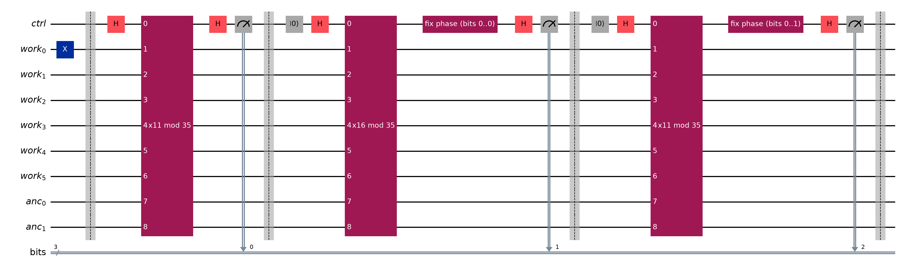

# Tier 8: The Wrapped Key, N = 35, explained simply

**Answer:** `QC-08: inside is a map of old tunnels under Ohio Stadium`
**Factors:** 35 = 5 × 7, **private exponent** d = 5, **key** k = 18 = `010010`
**Main method:** Shor's algorithm (order finding), in `solution.py`.
**Checker:** full match, circuit run on Aer.

Files in this folder:

| File | What it is |
|---|---|
| `solution.py` | Submitted solution: Shor with one recycled control qubit |
| `grover_factoring.py` | Second quantum method: Grover search for p × q = 35 (has a working `solve()` too) |
| `explore.py` | Runs every method side by side: classical, Shor (2 versions), Grover, noise |
| `explore_output.txt` | What `explore.py` printed |
| `benchmark.json` | Same numbers in one machine-readable table (success, gates, depth, time, noise) |
| `diagram_shor.png`, `diagram_grover.png` | Circuit diagrams (each big block drawn as one box) |

---

## 1. What the file hid, and how we picked the method

The message is XOR-locked with a 6-bit key `k`, and `k` is **wrapped with RSA**:

- public: N = 35, e = 5, wrapped key c = k^e mod N = 23
- to unwrap: k = c^d mod N, where d = e^−1 mod (p−1)(q−1)

We need the **factors p and q of N**. Breaking RSA means factoring, and the quantum algorithm for factoring is **Shor's algorithm**. The README hints (the order r with a^r = 1 mod N, "a circuit can measure how often something repeats") are the steps of Shor. The rules forbid classical factoring such as trial division in the solution, so classical code appears here only as a comparison.

## 2. Why Shor works (beginner version)

**Step A: factoring becomes "find the repeat length".** Pick a = 2 and list 2^x mod 35:

```
x          : 0  1  2  3  4   5   6   7   8  ...  12  13 ...
2^x mod 35 : 1  2  4  8  16  32  29  23  11 ...   1   2 ...   (repeats every r = 12)
```

The list repeats with **period r = 12**. Then a little classical maths gives the factors:

```
2^(r/2) mod 35 = 2^6 mod 35 = 29
gcd(29 − 1, 35) = gcd(28, 35) = 7
gcd(29 + 1, 35) = gcd(30, 35) = 5
```

(This works because 29² = 1 mod 35, so 35 divides (29−1)(29+1) without dividing either one alone.)

**Step B: a quantum circuit measures the period.**
- "Multiply by 2 mod 35" is a reversible step `U|x⟩ = |2x mod 35⟩`. Doing it 12 times returns to the start, so U acts like a **clock hand that turns 1/12 of a circle** per step.
- **Phase estimation** reads how far the hand turns per step. It returns a fraction **s/12** for a random s.
- We measure 10 bits y, so y / 1024 ≈ s/12. **Continued fractions** find the closest simple fraction, and its bottom number gives r.

**Step C: unwrap the key.** φ = 4 × 6 = 24, d = 5^−1 mod 24 = 5, k = 23^5 mod 35 = 18, so `key_bits = 010010`.

## 3. Circuit (main solution)



Textbook Shor uses 10 counting qubits. Our solution uses **one control qubit, reused 10 times**: measure it, reset it, use it again (the "semiclassical QFT"). Each round: H on the control, controlled "× b mod 35" with b = 2^(2^j) mod 35, a small phase correction from the bits already read (this replaces the inverse QFT), H, measure.

**How "× b mod 35" is built:** multiplying by b only **reorders** the numbers 1..34. The circuit does the reordering as a chain of swaps of two values; each swap is a few CNOTs plus one multi-controlled X. The work register never holds 0 or a value ≥ 35, so those patterns are "don't care", which lets us drop some controls. The construction is checked classically on all 34 inputs.

| | Count |
|---|---|
| Qubits | 9 = 1 control + 6 work + 2 helper ancillas |
| Rounds (phase bits) | 10, since 2^10 ≥ 35²/2 |
| Scored circuit (checker) | **5053 two-qubit gates**, depth 10 406, 14 920 gates, 9 active qubits |
| Shots | 24 |

## 4. Measurement result and key extraction

24 shots of the 10-bit y (from `explore_output.txt`): the peaks sit at multiples of 1/12 (85/1024 ≈ 1/12, 425/1024 ≈ 5/12, 597/1024 ≈ 7/12, 939/1024 ≈ 11/12), plus fractions of smaller denominator when s and 12 share a factor (1/6, 1/4, 1/3, 1/2, 2/3, 5/6). Taking the smallest candidate (including lcm of pairs) with 2^r = 1 mod 35 gives **r = 12**, then gcd gives **5 and 7**, d = 5, k = 18 and the line.

## 5. Different approaches we tried (`explore.py`, `benchmark.json`)

Quantum methods, all run on Aer:

| Method | Qubits | 2Q gates | Depth | Chance a run finds 5 × 7 | Time to solve |
|---|---|---|---|---|---|
| **Shor, recycled control** (submitted) | 9 | 5053 | 10 425 | 100% (24 shots) | 1.2 s |
| Shor, textbook (10 counting qubits + inverse QFT) | 18 | 4966 | 10 007 | 100% (24 shots) | 91 s (240 shots, one big simulation) |
| Grover factoring (search 32 pairs for p × q = 35) | 12 | **1776** | 2278 | 96.4% per shot | 0.8 s |

**Recycled vs textbook Shor:** same multipliers and same gate count, but recycling halves the qubits (18 down to 9) and is about 75× faster to simulate.

**Grover factoring, beginner version:** "find p, q with p × q = 35" is a search over 32 candidate pairs (both odd, p ≤ 7, q ≤ 15). The oracle really **multiplies** with phase gates (Draper adder), flips the sign when the product is 35, and undoes it. Two pairs are right, (5,7) and (7,5), so 3 rounds give 96.1% by theory (96.4% measured). It is ~3× smaller than Shor here. Grover only gives a √ speed-up, Shor an exponential one, so Grover wins at toy size and loses at real size. We kept Shor as the submission because it is the scalable algorithm.

**Success against rounds (Grover):** 0 rounds 5%, 1: 47%, 2: 90%, **3: 96%**, 4: 58%, 5: 14%, 6: 2%. More rounds is worse after the best one: the state rotates past the answer.

**Which base `a` (Shor)?** Chance that k random shots give the factors (from 240 real shots, bootstrapped):

| a | order r | k=1 | k=2 | k=4 | k=8 | k=24 |
|---|---|---|---|---|---|---|
| 2 | 12 | 34% | 64% | 93% | 99.6% | 100% |
| 3 | 12 | 35% | 68% | 93% | 99.8% | 100% |
| 4 | 6 | 29% | 65% | 93% | 99.7% | 100% |
| 8 | 4 | 47% | 74% | 94% | 99.5% | 100% |
| 34 | 2 | 0% | 0% | 0% | 0% | 0% |

a = 34 has order 2 and 34 = −1 mod 35, so it gives only the trivial factors 1 and 35. A good base can only be chosen safely by trying: choosing 34 *on purpose* needs the factors already, so we use the plain a = 2 and retry another a if it fails.

**How many phase bits t? (a = 2)** Chance that one shot / 8 shots give the factors:

| t | 4 | 5 | 6 | 7 | 8 | 9 | **10** |
|---|---|---|---|---|---|---|---|
| 1 shot | 0% | 0% | 10% | 15% | 26% | 27% | 37% |
| 8 shots | 0% | 0% | 83% | 97% | 98% | 99% | 100% |

Too few bits blur s/12, so continued fractions cannot see r = 12. The rule t = ⌈log₂(N²/2)⌉ = 10 is safe, and every extra bit costs one more round.

## 6. Classical cost compared with quantum

| Method | Work for N = 35 | Wall time here | Growth with n-bit N |
|---|---|---|---|
| Trial division | 4 divisions | 0.3 µs | ~2^(n/2) |
| Fermat | 1 check (5 and 7 are close) | 0.3 µs | bad when factors are far apart |
| Pollard rho | 1 round | 0.3 µs | ~2^(n/4) |
| Classical order finding (what Shor replaces) | 12 multiplications | µs | up to ~2^n |
| Best classical (number field sieve) | n/a | n/a | sub-exponential, ~2^(n^(1/3)) |
| **Shor** | 10 rounds × 24 shots | 1.2 s (simulated) | **polynomial, ~n³ gates** |

**Honest limit:** at N = 35 every classical method wins on time by a factor of a million. Our multiplier is built from the full table x → bx mod 35, which is O(N) classical work. A scalable Shor builds "× b mod N" from **adders** (O(n²) gates, about 2n + 3 qubits), not from a table. Our circuit shows the mechanism, not a real speed-up.

## 7. Noise (from `explore.py`, part 5)

Random errors after every CX (depolarizing, probability p), on the actual circuits:

| Error per CX | Shor: shots on a peak | Shor: 8 shots find factors | Grover: success |
|---|---|---|---|
| 0 | 97% | 99% | 98% |
| 0.0001 | 82% | 99.6% | 83% |
| 0.0003 | 50% | 97% | 65% |
| 0.001 (today's hardware) | 13% | 64% | 31% |

A random bit string lands on a peak 2.7% of the time, so a scrambled Shor circuit falls to that level. Shor is the more noise-tolerant method in practice, because it only needs a handful of correct peaks out of many shots and each shot is checked classically, while Grover needs its single amplified answer. At p = 0.001 both still work a little, because 5000 CX at 0.1% leaves some shots error-free; this does not scale. Error mitigation (zero-noise extrapolation, probabilistic error cancellation) could stretch the range by a factor of a few, but real sizes need error correction.

## 8. Scaling and hardware

- **RSA-2048:** ~4 000+ error-corrected qubits and billions of gates. Published estimates are ~20 million noisy qubits over 8 hours (Gidney & Ekerå, 2019), and under 1 million noisy qubits in under a week (Gidney, 2025).
- **Our circuit at real size:** a table-based multiplier grows like 2^n and cannot be built for n = 2048. The adder-based multiplier grows like n².
- **Resource trend we measured:** N = 35 → 5053 CX; N = 77 (tier 9) → 23 968 CX, about 5× more for 1 more bit-width and a longer period. That is the table construction's growth, and it is why the scalable construction matters.
