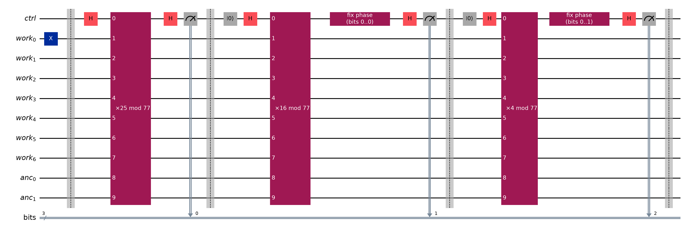

# Tier 9: The Wrapped Key, N = 77, explained simply

**Answer:** `QC-09: follow it south past Gate 17 to a door painted scarlet`
**Factors:** 77 = 7 × 11, **private exponent** d = 43, **key** k = 31 = `0011111`
**Main method:** Shor's algorithm (order finding), in `solution.py`.
**Checker:** full match, circuit run on Aer.

Files in this folder:

| File | What it is |
|---|---|
| `solution.py` | Submitted solution: Shor with one recycled control qubit |
| `grover_factoring.py` | Second method we tried: Grover search for p × q = 77 (also has a working `solve()`) |
| `explore.py` | Runs every method side by side, plus classical methods |
| `explore_output.txt` | What `explore.py` printed |
| `diagram_shor.png`, `diagram_grover.png` | Circuit diagrams |

---

## 1. What the file hid, and how we picked the method

The message is XOR-locked with a 7-bit key `k`, and `k` is **wrapped with RSA**:

- public: N = 77, e = 7, wrapped key c = k^e mod N = 59
- to unwrap: k = c^d mod N, where d = e^−1 mod (p−1)(q−1)

To get `d` we need the **factors p and q of N**. Breaking RSA means factoring, and the quantum algorithm for factoring is **Shor's algorithm**. The README hints (order r with a^r = 1 mod N, "measure how often something repeats") are the steps of Shor.

## 2. Why Shor works (beginner version)

**Step A: factoring becomes "find the repeat length".**
Pick a = 2 and list 2^x mod 77:

```
x       : 0  1  2  3   4   5   6  ...  30  31 ...
2^x mod 77: 1  2  4  8  16  32  64  ...   1   2 ...   (repeats every r = 30)
```

The list repeats with **period r = 30**. Once we know r, a little classical maths gives the factors:

```
2^(r/2) mod 77 = 2^15 mod 77 = 43
gcd(43 − 1, 77) = gcd(42, 77) = 7
gcd(43 + 1, 77) = gcd(44, 77) = 11
```

(This works because 43² = 1 mod 77, so 77 divides (43−1)(43+1) without dividing either factor alone.)

**Step B: a quantum circuit measures the period.**
- "Multiply by 2 mod 77" is a reversible step `U|x⟩ = |2x mod 77⟩`. Doing it 30 times returns to the start, so U behaves like a **clock hand that turns 1/30 of a circle** per step.
- **Phase estimation** reads how far that clock hand turns per step. It returns a fraction **s/30** for a random s.
- We measure 12 bits y, so y / 4096 ≈ s/30. The **continued fractions** method finds the closest simple fraction, and its bottom number gives r.

**Step C: unwrap the key.** φ = 6 × 10 = 60, d = 7^−1 mod 60 = 43, k = 59^43 mod 77 = 31, so `key_bits = 0011111`.

## 3. Circuit (main solution)



Textbook Shor uses 12 counting qubits. Our solution uses **one control qubit, reused 12 times**: measure it, reset it, and use it again (the "semiclassical QFT"). Each round:

1. H on the control
2. controlled "× b mod 77", where b = 2^(2^j) mod 77 (computed classically by repeated squaring)
3. a small phase correction based on the bits already measured (this replaces the inverse QFT)
4. H, then measure, which gives one bit of y

**How "× b mod 77" is built:** multiplying by b only **reorders** the numbers 1..76 (a permutation). The circuit performs this reordering as a chain of swaps of two values. Each swap is a few CNOTs plus one multi-controlled X. The work register never holds 0 or a value ≥ 77, so those patterns are "don't care", which lets us drop some controls. The construction is checked classically on all 76 inputs.

| | Count |
|---|---|
| Qubits | 10 = 1 control + 7 work (77 needs 7 bits) + 2 helper ancillas |
| Rounds (phase bits) | 12, since 2^12 ≥ 77²/2 (enough precision for continued fractions) |
| Scored circuit (checker) | **23 968 two-qubit gates**, depth 45 696, 70 246 gates, 10 active qubits |
| Shots | 24 |

## 4. Measurement result and key extraction

24 shots of the 12-bit y (from `explore_output.txt`):

| y | y / 4096 | closest fraction s/r | r guess |
|---|---|---|---|
| 137 | 0.0334 | 1/30 | **30** |
| 1775 | 0.4333 | 13/30 | **30** |
| 2321 | 0.5667 | 17/30 | **30** |
| 3140 | 0.7666 | 23/30 | **30** |
| 273, 546, 1092 | | 1/15, 2/15, 4/15 | 15 (divides 30) |
| 683, 2867, 3687 | | 1/6, 7/10, 9/10 | 6, 10 |
| 820, 2459, 3277 | | 1/5, 3/5, 4/5 | 5 |
| 0 | 0 | 0 | useless shot |

Every peak sits at a multiple of 1/30. A shot can show a **divisor** of r (when s and 30 share a factor), so we take the smallest candidate (including lcm of pairs) with 2^r = 1 mod 77, which gives **r = 30**. Then gcd gives **7 and 11**, followed by d = 43, k = 31, and the line.

## 5. Different approaches we tried (`explore.py`)

| Method | What it does | Qubits | 2Q gates | Found 7 × 11? |
|---|---|---|---|---|
| **Shor, recycled control** (submitted) | 12 rounds on one control qubit | 10 | 23 968 | yes, r = 30 |
| Shor, textbook | 12 counting qubits + inverse QFT | 21 | 24 198 | yes, r = 30 (36 s to simulate vs 1.5 s) |
| Grover factoring | search 64 pairs (p, q) for p × q = 77 | 13 | **4 056** (checker: 4 158) | yes, 64/64 shots |

**Textbook vs recycled Shor:** same multipliers, so similar gate count, but recycling halves the qubits (21 down to 10) and runs ~25× faster in simulation.

**Grover factoring, beginner version:** "find p, q with p × q = 77" is a search.
- Both factors are odd, and the smaller p ≤ √77 ≈ 8.8. So p ∈ {1,3,5,7} (2 qubits) and q is odd ≤ 31 (4 qubits): 64 candidates, exactly one right.
- The oracle really **multiplies**, using p × q written as a sum of terms added with phase gates (a "Draper" Fourier adder). It flips the sign when the product is 77, then undoes the multiplication.
- 6 Grover rounds give a 99.7% chance of success.

It is about **6× smaller** than Shor here. The catch: Grover only gives a √ speed-up (it searches √N-ish candidates in about N^(1/4) steps), while Shor is exponentially faster for big N. Grover wins at toy size; Shor wins at real size. We kept Shor as the submission because it is the scalable algorithm and the one the tier asks for ("as in tier 8"). The Grover file is a drop-in replacement if the team wants the smaller circuit.

**A trap we avoided:** a = 34 has order r = 2, which would make the circuit nearly empty. But you can only know to choose 34 if you already know the factors (34 = 1 mod 11, −1 mod 7). Choosing a base that way would be cheating, so we use the plain a = 2.

## 6. Classical cost compared with quantum

| Method | Work for N = 77 | Growth with n-bit N |
|---|---|---|
| Trial division | 6 divisions | ~2^(n/2) |
| Fermat | 1 check (7 and 11 are close together) | bad when the factors are far apart |
| Pollard rho | 1 round | ~2^(n/4) |
| Classical order finding (what Shor replaces) | 30 multiplications | up to ~2^n |
| Best classical (number field sieve) | n/a | sub-exponential, ~2^(n^(1/3)) |
| **Shor** | 12 rounds × 24 shots | **polynomial, ~n³ gates** |

**Honest limit:** our multiplier is built from the full table x → bx mod 77, which is O(N) classical work. That is more than factoring 77 by hand. A scalable Shor builds "× b mod N" from **adders** (O(n²) gates), not from a table. Our circuit shows the mechanism, not a real speed-up.

## 7. Scaling and hardware

- **RSA-2048:** n = 2048 bits needs ~4 000+ error-corrected (logical) qubits and billions of gates. Published estimates are ~20 million noisy qubits over 8 hours (Gidney & Ekerå, 2019), and fewer than 1 million noisy qubits in under a week (Gidney, 2025).
- **Noise:** our 24 000-CX circuit at 0.1% error per gate would be fully scrambled (expected errors ≈ 24). Even N = 77 needs error correction or a far smaller multiplier. The Grover version (4 000 CX) is still ~4 expected errors per run.
