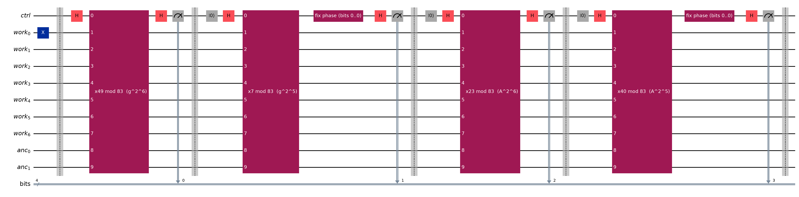

# Tier 10: The Handshake, explained simply

**Answer:** `QC-10: knock four times, shout O-H, and wait for the I-O`
**Secret exponent:** a = 14 (A = 3^14 mod 83 = 11), **shared secret** B^a mod 83 = 49^14 mod 83 = 23 = `0010111`
**Main method:** Shor's discrete logarithm, in `solution.py`.
**Checker:** full match, circuit run on Aer.

Files in this folder:

| File | What it is |
|---|---|
| `solution.py` | Submitted solution: Shor's discrete log with one recycled control qubit |
| `grover_dlog.py` | Second quantum method: Grover search over exponents (circuit and probability sweep) |
| `explore.py` | Runs every method side by side: classical, Shor (2 versions), Grover, noise |
| `explore_output.txt` | What `explore.py` printed |
| `benchmark.json` | Same numbers in one machine-readable table (success, gates, depth, time, noise) |
| `diagram_shor.png`, `diagram_grover.png` | Circuit diagrams (each big block drawn as one box; Grover shows 2 of its 4 rounds) |

---

## 1. What the file hid, and how we picked the method

Alice and Bob did Diffie-Hellman in a small group:

- public: prime p = 83, generator g = 3 whose **order is 41** (g^41 = 1), A = g^a = 11, B = g^b = 49
- the shared secret is B^a mod p (equal to A^b), and it keys the XOR lock

Recovering **one** exponent is enough, so we need the **discrete logarithm**: find a with g^a = A. The quantum algorithm for it is Shor's. The README hint ("f(x1, x2) = g^x1 · A^x2 repeats in two dimensions and hides a") says the same: tier 8 found a repeat in one dimension, tier 10 needs two.

## 2. Why it works (beginner version)

Take two reversible steps on numbers in the group {powers of 3}:

- `U_g |x⟩ = |g·x mod p⟩` (multiply by g) and `U_A |x⟩ = |A·x mod p⟩` (multiply by A).

Since A = g^a, **U_A is just U_g applied a times**. Both steps are "clock hands" turning around a circle of 41 positions:

- U_g turns the hand by **s/41** of a circle, for some s
- U_A turns it by **s·a/41** (a times as far)

Phase estimation reads these two angles on the same quantum state. The state |1⟩ is an equal mix of all 41 possible s values, so each shot gives a random s:

1. Estimate U_g: we get s.
2. Estimate U_A on the same register: we get s·a mod 41.
3. Divide: **a = (s·a) · s⁻¹ mod 41**. (The inverse exists because 41 is prime; shots with s = 0 say nothing and are skipped.)

This is the two-dimensional repeat pattern of f(x1, x2) = g^x1 A^x2 mod p, read one dimension after the other. We take 7 bits for each reading (2^7 = 128 > 2·41), and vote over many shots: right shots all vote for the same a, wrong shots scatter.

## 3. Circuit (main solution)

Same trick as tier 8: **one control qubit, reused** (measure, reset, reuse), 7 rounds for U_g then 7 rounds for U_A, 14 in total. Each round: H, controlled "× b mod 83" with b = g^(2^j) or A^(2^j) (from repeated squaring), a phase correction from the bits already read, H, measure.

**How "× b mod 83" is built:** multiplying by b reorders the 41 subgroup elements. The circuit does that as a chain of swaps (a few CNOTs plus one multi-controlled X each). The work register only ever holds powers of 3, so every other bit pattern is "don't care", which lets us drop controls. It is checked classically on all 41 values. This costs O(41) gates per multiplication, so it is a toy construction.

| | Count |
|---|---|
| Qubits | 10 = 1 control + 7 work (83 needs 7 bits) + 2 helper ancillas |
| Rounds | 14 (7 + 7) |
| Scored circuit (checker) | **13 157 two-qubit gates**, depth 26 139, 37 393 gates, 10 active qubits |
| Shots | 40 |

## 4. Measurement result and key extraction

Each shot is a pair (y_g, y_A). From `explore_output.txt` (40 shots): y_g · 41 / 128 ≈ s and y_A · 41 / 128 ≈ s·a. For example the shot (3, 43) gives s = 1, s·a = 14, so a = 14; the shot (75, 25) gives s = 24, s·a = 8, and 8 · 24⁻¹ mod 41 = 14.

Votes: **a = 14 got 34 votes**, and three other candidates got 1 vote each; 2 shots had s = 0 and carried no information. A last classical check 3^14 mod 83 = 11 = A confirms it. Then secret = 49^14 mod 83 = 23 = `0010111`, and the line decrypts.

## 5. Different approaches we tried (`explore.py`, `benchmark.json`)

Quantum methods, all on Aer:

| Method | Qubits | 2Q gates | Depth | Success | Time |
|---|---|---|---|---|---|
| **Shor dlog, recycled control** (submitted) | 10 | 13 157 | 26 139 | 100% with 40 shots (85% for a single shot) | 3.9 s |
| Shor dlog, textbook (two counting registers at once) | 23 | 13 313 | 26 178 | sized only (not simulated, 2^23 amplitudes) | n/a |
| Grover over exponents (4 rounds) | 15 | 49 698 | 97 786 | 99.9% per shot | 438 s (sweep of 5 rounds) |

**Recycled vs textbook Shor:** same multipliers and almost the same gate count, but the textbook version needs 13 more qubits (23 against 10). U_g and U_A commute, so reading them in parallel or one after the other gives the same (s, s·a) pairs. We built the textbook circuit and measured its size; simulating it takes a 2^23-amplitude statevector (set `TIER10_SIMULATE_TEXTBOOK=1` in `explore.py` to try).

**Grover over exponents, beginner version:** "find x with 3^x = 11" is a search. A 6-qubit register holds x = 0..63. The oracle really computes 3^x mod 83 into the work register (controlled multiplications, the same blocks as Shor), flips the sign if it equals A, and undoes it. Because g has order 41, x = 14 and x = 55 are both right (2 marked items), so ~4 rounds are best:

| Rounds | 0 | 1 | 2 | 3 | **4** | 5 |
|---|---|---|---|---|---|---|
| Chance one shot is right | 3% | 26% | 60% | 90% | **99.9%** | 86% |

This matches theory sin²((2k+1)θ) exactly. Grover is **3.8× larger** than Shor here (49 698 against 13 157 CX) because the oracle does full modular exponentiation twice per round. It also barely beats brute force in queries (4 rounds against up to 41 checks), so it has no real advantage at this size.

**How many phase bits t? (Shor)** One shot's vote, and the top vote of 16 shots:

| t | 4 | 5 | 6 | **7** | 8 | 9 |
|---|---|---|---|---|---|---|
| 1 shot right | 7.5% | 39.5% | 74.5% | 85.5% | 86.5% | 94% |
| 16 shots find a | 15% | 99.2% | 100% | 100% | 100% | 100% |

t = 7 (2^t > 2q) is the size where rounding is guaranteed to return s for the closest peaks. With voting, t = 5 or 6 already works, so fewer rounds would be enough here. t = 4 is too coarse.

**How many shots? (t = 7)** Chance the top vote is right: 1 shot 83%, 2 shots 86%, 4 shots 98%, 8 shots and more 100%.

## 6. Classical cost compared with quantum

Classical methods, run on the real parameters (comparison only; the rules forbid them in the solution):

| Method | Steps | Wall time | Growth with group order q |
|---|---|---|---|
| Brute force (try a = 0, 1, 2, ...) | 15 (41 worst) | 0.6 µs | ~q |
| Lookup table of all powers | 41 | 12 µs | ~q (and memory ~q) |
| Baby-step giant-step | 10 | 1.6 µs | ~√q (and memory ~√q) |
| Pollard rho | 12 | 27 µs | ~√q |
| **Shor dlog** | 14 rounds × 40 shots | 3.9 s (simulated) | **polynomial in log q** |

**Honest limit:** at q = 41 every classical method finishes about a million times faster than our simulated circuit. The point is the growth: for a 2048-bit group the best classical attacks (index calculus, ~2^(n^(1/3))) are far out of reach, while Shor needs only polynomially many gates. For elliptic curves, the best classical attack is Pollard rho at ~2^(n/2), which makes Shor's advantage even bigger. Our multiplier uses the full table of 41 values, which does O(q) classical work; a scalable version builds "× b mod p" from adders in O(n²) gates.

## 7. Noise (from `explore.py`, part 5)

Random errors after every CX (depolarizing, probability p), simulated on the real circuit for Shor:

| Error per CX | Shor: shot votes right | Shor: 16 shots find a | Grover (estimate) |
|---|---|---|---|
| 0 | 85% | 100% | 99.9% |
| 0.0001 | 30% | 95% | 3% |
| 0.001 (today's hardware) | 0% (2.4% = random) | 0% | 2.4% (random) |

Shor needs only a few correct shots out of many, and each answer is checked classically, so it tolerates ten times more noise than Grover. **The Grover column is an estimate, not a simulation:** a run with no CX error at all (chance (1 − p)^49 698) succeeds as ideal, any error counts as a random guess (1/41). Noisy simulation of the Grover circuit was too slow. At today's error rate neither circuit survives; zero-noise extrapolation and error cancellation add a small factor at best, so error correction is needed.

## 8. Scaling and hardware

- **Real Diffie-Hellman (2048-bit group) or elliptic curve (256-bit):** a few thousand error-corrected qubits and billions of gates. Elliptic-curve discrete logs need fewer qubits than RSA of the same security (Roetteler et al., 2017: ~2330 logical qubits for 256-bit curves).
- **Our toy construction:** the table-based multiplier grows like q. At real sizes it must be replaced by adder-based modular arithmetic.
- **Resource trend we measured:** the discrete log circuit (13 157 CX) is about 2.5× the factoring circuit of tier 8 (5053 CX) because it estimates two phases, 14 rounds in total, against 10.
